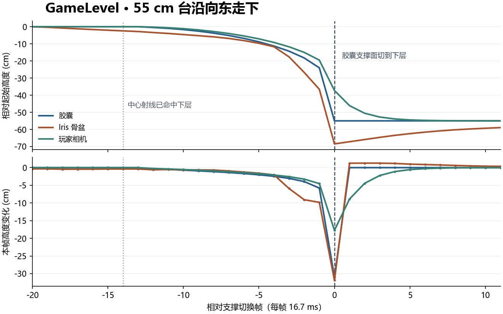

# GameLevel 实际台沿：哪一步让 Iris 突然下坠

[台沿与落地检查](LandingAndShoulderTests.md) / GameLevel 实地复测

**下坠发生在角色移动组件切换支撑面的那一帧。** Iris 肩射走下 55 cm 台沿时，胶囊先沿上沿逐渐下降了约 24 cm。下层地面被选为可行走支撑后，`AdjustFloorHeight` 在一帧内补完余下 **30.96 cm**。同帧源骨架 Quinn 的骨盆下降 31.86 cm，可见 Iris 的骨盆下降 31.88 cm，玩家相机下降 17.74 cm。整个过程保持 Walking。

## 先看胶囊还压在哪一层

主测点是关卡原有的武器标记台 `WB_WeaponMarker_06`。其实测顶面 Z = 55 cm，下层 `WB_Ground_60x44m` 在 Z ≈ 0 cm。由顶面坐标 (−112, −1650) 沿 +X 前进，东沿位于 X = −60 cm。固定 60 Hz，监听主机持突击步枪肩射，跨沿时水平速度 150 cm/s。表内负数表示相对此前一帧下降。

| 相对支撑切换帧 | 胶囊认定的支撑面 | 胶囊 ΔZ | Quinn 骨盆 ΔZ | Iris 骨盆 ΔZ | 玩家相机 ΔZ |
| ---: | --- | ---: | ---: | ---: | ---: |
| −14 | 上沿；中心竖直射线已命中下层 | 0.00 | −0.38 | −0.39 | 0.00 |
| −2 | 上沿 | −3.94 | −8.98 | −9.09 | −3.25 |
| −1 | 上沿 | −5.78 | −9.74 | −9.82 | −4.51 |
| **0** | **下层地面** | **−30.96** | **−31.86** | **−31.88** | **−17.74** |
| +1 | 下层地面 | 0.00 | +1.23 | +1.25 | −8.87 |
| +2 | 下层地面 | 0.00 | +1.25 | +1.28 | −4.43 |

1. **中心越沿后，胶囊仍搭在上面。** 第 87 帧中心 X = −59.26，向下射线已经看到低处。到第 100 帧，中心到了 X = −26.76，距边缘 33.24 cm，半径 35 cm 的胶囊仍通过扫掠在 X ≈ −60、Z ≈ 55 的上沿找到支撑。此时胶囊中心 Z = 123.11 cm，垂直速度仍为零。
2. **第 101 帧，贴地校正产生突降。** 中心到 X = −24.26，已越沿 35.74 cm。权威角色的 `FindFloor` 在 Z = 123.109 处查地，支撑换为下层可行走平面。胶囊半高为 90 cm，底部距下层约 33.11 cm。UE 此处取地面间隙目标 2.15 cm，所需校正为 2.15 − 33.11 ≈ −30.96 cm。引擎日志报出 `Adjust floor height -30.959 (Hit = 0)`；同次角色移动更新的起止中心 Z 为 123.109 → 92.150 cm。帧末记录的 `FloorDist` 已是校正后的 2.15 cm。
3. **骨盆同帧下移，相机分帧追随。** 第 101 帧 Quinn 和 Iris 的骨盆降幅只差 0.02 cm；下一帧胶囊已经停在下层，骨盆开始回升，相机还在下降。这次大幅位移在角色移动更新内已经产生，重定向与镜头滞后影响它最终看起来有多重。

## 重复与对照

同一东沿重放两次，再从同一标记台的西沿向 −X 走一次。三次中心射线都比胶囊支撑早 14 帧（约 233 ms）切到下层，权威贴地校正都是 −30.959 cm。这里的 55 cm 是上下层高差；角色走到最后一个上沿接触点时，剩余间隙已经小于项目实测的最大台阶高度 45 cm。

电车站的关卡构件提供了另一条路径。从 `WB_TramStation_Stair_Step_02` 沿 +Y 走下侧沿，顶面 Z = 93.44 cm，`WB_TramStation_Floor` 在 Z = 15.00 cm，落差 **78.44 cm**。失去上沿时胶囊底离下层约 56.78 cm，超过这次 Walking 查地范围约 47.4 cm。移动组件进入 Falling，经过 21 帧（约 350 ms）后落地。两处可分别用来回归“行走中切换支撑”和“走出后实际下落”。

## 肩射表现平滑的设计与验收

对 55 cm 台沿，保留胶囊在支撑切换帧完成贴地校正的行为。角色肩射、前后移动更新均为 Walking、上下两次支撑接触点存在明显落差且本次胶囊突然下移时，在第三人称角色表现和本机肩射相机上暂时抵消该次下移，再在短时间内把补偿收回到零。普通行走、真正进入 Falling 和落地帧沿用原运动表现。比较同一输入下的单帧最大下移、补偿消失的时间、胶囊及实际支撑帧；78.44 cm 电车站侧沿逐帧比较进入 Falling、触地和空中三条轨迹。

实际改动和复测见[肩射下台沿的前后对照](ShoulderLedgeSmoothing.md)。下文保留首次定位使用的数据。

## 原始诊断如何复查

2026-11-26，UE 5.8，GameLevel 原有碰撞，无渲染双人监听服 PIE。对齐同一主机角色的移动更新起止位置、帧末 `CurrentFloor`、独立中心射线、两套骨盆世界坐标及玩家相机管理器位置。引擎校正值取自该权威角色的 `LogCharacterMovement`。源码入口是 `UCharacterMovementComponent::PhysWalking` 中的查地与可行走判断，以及 `AdjustFloorHeight` 中按当前间隙移动胶囊的调用。

[四次走测逐帧 CSV](GameLevelLedgeFrames.csv) 每次保留第 61–180 帧，试次 1、2 为标记台向东，3 为向西，4 为电车站侧沿；相对第 0 帧分别是支撑切换和进入 Falling。距离单位 cm，速度单位 cm/s。
