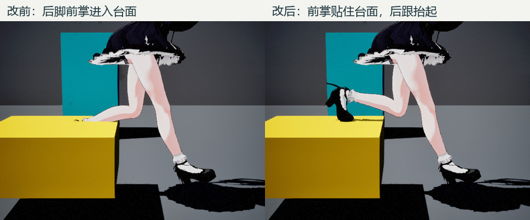

# Iris 下台沿时，支撑脚如何离开上层

[角色与战斗进度](../CombatProgress.md) / [如何测量鞋底接触](LedgeFootContact.md)

**Iris 肩射走下 GameLevel 的 55 cm 标记台时，后脚前掌现在能贴住台面，再随角色迈出。** 标准东沿路线的鞋底最大穿入从 **23.65 cm 降至 0.71 cm**。前脚鞋跟仍在胶囊换到下层后的第 5 帧接近地面。下图是两次独立 PIE 在同一帧的实录，持枪姿势、下层脚和镜头位置相同。

## 同一台沿，换一种迈步还管用吗？

以下均为 60 Hz、步枪肩射、150 cm/s。表中取胶囊切换支撑前后各 18 帧，统计两只鞋的后跟、前掌四个网格测点在上层的**最大穿入深度**。每个点都按自己正下方实际命中的碰撞面计算；改后最深点可能换脚、换帧。

| 走法 | 改前 | 改后 |
| --- | ---: | ---: |
| 主机前进，距东沿 52 cm 起步 | 23.65 cm | **0.71 cm** |
| 客户端自己操控，同一东沿 | 23.65 cm | **0.71 cm** |
| 主机前进，同一台子的西沿 | 23.74 cm | < 0.01 cm |
| 距东沿仅 12 cm 起步，后段只剩鞋跟搭边 | 36.44 cm | **1.81 cm** |
| 距东沿 30 / 70 cm 起步 | 14.30 / 15.34 cm | 1.70 / 0.24 cm |
| 横向肩射走出东沿 | 18.19 cm | **2.00 cm** |
| 倒退走出东沿 | 3.39 cm | 3.39 cm |

在标准东沿支撑切换前一帧，改前后脚鞋跟和前掌分别陷入上层 12.04、23.65 cm。改后鞋跟已抬高约 11.67 cm，前掌测点留在台面附近，前脚鞋跟仍离下层 13.86 cm。此时两腿之间的高度差由后腿屈膝吸收。骨盆在这一帧仍下降 9.82 cm，后续调整身体重心可以单独以此为基线。

### 身体提前降重心的验收

后续已完成这项调整。标准东沿骨盆单帧下移峰值进一步降至 5.93 cm，前脚接地时机保持在第 +5 帧。[提前屈膝的同机位慢放与全部走测](IrisLedgeWeightTransfer.md)

当脚下已查到较低的可行走面、胶囊还压着上沿时，让 Iris 提前屈膝，把部分骨盆下降分摊到前面的步幅。按胶囊越过上沿的距离、两层高差和当前动画的骨盆高度确定额外降幅。原姿势开始快速下降后，收回提前施加的高度差。身体和持枪外观同步，腿部 IK 保住前后脚原先的世界空间目标。胶囊、镜头和实际枪口沿用现有轨迹。用 55 cm 东西沿、不同起步距离、横移、倒退与不同帧率比较骨盆下移和向上反弹的峰值，同时核对足底、平地与 78.44 cm 真实下落。

## 哪一层负责这次修正

1. **识别可以踏下的台沿。** Iris 肩射、胶囊处于 Walking，且当前支撑点偏离胶囊中心时，在中心下方查找较低的可行走面。两层相差 12–65 cm 时记住上沿构件和接触点。换到下层后短暂保留上沿，后脚可以走完这一步。离开附近、退出肩射或进入 Falling 时清除记录。
2. **分别计算每只鞋还搭着多少。** 对 Iris 原动画图的最终姿势，取踝骨上的鞋跟点和趾骨上的前掌点，加上身体当帧的绘制偏移。两端都在上层时，按实际穿入量抬脚。一端已经越沿时，在鞋底两点之间二分查找边界；若搭着的长度不足 65%，向外挪脚所需距离又比向上抬脚短，可沿鞋底朝已离台的一端让开边缘。
3. **保留脚掌原有的滚动。** 用两段腿骨 IK 屈膝，并保留原踝部朝向和腿长。只有鞋底实际越过边缘后才释放为避开台面而施加的抬升，释放速度按秒计算。骨盆、武器、肩射相机继续沿用之前的姿势与轨迹。[Iris 动画实例](../../Source/TPSCPP/Animation/IrisAnimInstance.cpp)

默认值集中在 `ABP_Iris` 类默认值的 **Foot Contact → Ledge Foot Settings**。最大抬脚 26 cm，沿鞋底让开边缘最多 8 cm，释放速度 150 cm/s。鞋跟与前掌偏移来自 Iris 本身的鞋底网格。更换鞋型时，应先校准这两个点，再调整抬脚量。[参数定义](../../Source/TPSCPP/Animation/IrisAnimInstance.h) · [Iris 动画蓝图](../../Content/Characters/Iris/ABP_Iris.uasset)

## 平地、真实下落与帧率回归

- **平地与电车站。** 主机和远程客户端分别持枪走过平地与电车站 78.44 cm 侧沿。改前改后，四个鞋底测点在整段取样窗口内的三维位置逐帧一致。60 Hz 下电车站仍在第 120 帧进入 Falling、第 141 帧落地，腾空 0.35 秒。
- **胶囊与持枪。** 对全部配对试次逐帧核对了胶囊、支撑面、移动模式、Quinn 与 Iris 骨盆、实际枪口、渲染代理原点和最终相机位置。以上读数在同一配置的改前改后逐帧一致。这里的远程数据是操作者自己的视角，弱网旁观者和射击命中属于另行验收的项目。
- **30 / 120 Hz。** 在各自帧率内重放同样的前进输入。55 cm 东沿的鞋底最大穿入分别从 26.11 → 0.74 cm、25.78 → 0.72 cm；78.44 cm 电车站的鞋底、骨盆、胶囊与镜头配对轨迹一致。帧率改变时，越沿的步态相位也会变化。

**自己复查。** 在 GameLevel 启动双人监听 PIE，保持已有的身体平滑开启。控制台用 `tps.IrisLedgeFeet 0` 关闭足部修正，`tps.IrisLedgeFeet 1` 恢复默认。标准东沿从 (−112, −1650) 向 +X 走出；电车站从 (1663.61, −1011.69) 向 +Y 走出侧沿。CSV 的 `host` 和 `client` 路线 1–5 分别为东沿两次、西沿、电车站和平地；`stride` 路线 1–5 对应 12、30、70 cm 起步、横移、倒退；`rate` 的路线 1、4 对应东沿与电车站。鞋底间隙为负表示穿入，单位 cm。[改前改后逐帧数据](IrisLedgeSupport.csv)
