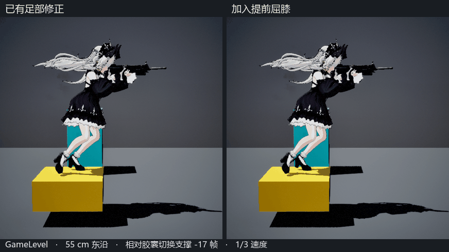

# Iris 如何把 55 cm 台沿走成一步

[角色与战斗进度](../CombatProgress.md) / [胶囊为什么会突然贴地](GameLevelLedge.md)

肩射以 150 cm/s 走下 GameLevel 武器标记台时，胶囊仍在一帧内下降 **30.96 cm**。在同一东沿、同一步态相位，Iris 可见骨盆的最大单帧下移从原始 **31.88 cm**，经贴地表现平滑降到 **9.82 cm**，再经提前屈膝降到 **5.93 cm**。肩射镜头从 **17.74 cm** 降到 **4.51 cm**。前脚鞋跟仍在换到下层支撑后的第 **+5 帧**到达离地 1 cm 内。

## 看哪几帧

以胶囊切换到下层支撑为第 0 帧，每帧约 16.7 ms。下表均为监听主机标准东沿首轮的**单帧下移量**，单位 cm。镜头取玩家相机管理器的最终位置，骨盆取实际画出的 Iris 高度。

| 时刻 | 原始骨盆 | 已有贴地平滑与足部修正 | 再加入提前屈膝 | 当前肩射镜头 |
| --- | ---: | ---: | ---: | ---: |
| −3 帧 | 5.93 | 5.93 | 5.93 | 2.56 |
| −2 帧 | 9.09 | 9.09 | 4.43 | 3.25 |
| −1 帧 | 9.82 | 9.82 | **2.48** | 4.51 |
| 第 0 帧 | **31.88** | 1.86 | **1.86** | **2.73** |
| 跨沿单帧峰值 | 31.88 | 9.82 | **5.93** | **4.51** |

两个顿挫发生在不同帧。第 0 帧由胶囊贴地带动全身下移，身体与肩射镜头各自追到新高度即可处理。第 −1 帧胶囊还压在上沿，此时角色原姿势本身已经快速下降。现在 Iris 在更早的步幅屈膝，到第 −3 帧已提前降低 12 cm；第 −2 帧只需保留 7.34 cm，到第 −1 帧已收回全部提前量。该帧最终站位与先前相同，抵达它的那一步从 9.82 缩短到 2.48 cm。[贴地前后的胶囊与镜头原始曲线](ShoulderLedgeSmoothing.md) · [支撑脚的前掌与后跟](IrisLedgeSupport.md)

## 技术实现与调参

1. **找到可以走下去的地方。** 在肩射 Walking 状态，胶囊中心已经探到下层、移动组件仍由上沿支撑，且角色速度指向台外时，才开始提前屈膝。用胶囊中心越出上沿的距离除以胶囊半径，得到这一步的进度。可识别的两层高差为 12–65 cm。
2. **只补动画还没走完的高度。** 根据越沿进度和两层高差得到期望下降量，再减去原动画骨盆已经完成的下降量。默认使用高差的 60% 计算目标，额外屈膝最多 12 cm，下降速度预算为 210 cm/s。原姿势自行下降时同步收回提前量。反向、松开肩射时，额外向上恢复的速度预算为 24 cm/s；起跳还能利用胶囊自身向上的位移伸腿。
3. **让鞋底和手里的枪跟对位置。** 身体与步枪外观使用相同的绘制偏移。腿部 IK 对踝部施加反向补偿，使鞋跟与前掌继续走原来的世界空间轨迹。镜头只接收已有的贴地平滑。提前屈膝阶段，模型和步枪外观最多比游戏侧位置低 **12 cm**；切换到下层的第 0 帧，已有贴地平滑让它们短时高出约 **30.02 cm**。实际枪口挂点仍跟随角色。弱网对手看到的轮廓和这一瞬间的实弹命中尚待单独核对。

四个重心参数在 `ABP_Iris` 类默认值的 **Foot Contact → Ledge Foot Settings**。先固定同一条路线和步态相位，再调整最大提前量；如果前脚接地时间跟着变动，应检查腿部补偿。[参数定义](../../Source/TPSCPP/Animation/IrisAnimInstance.h) · [重心与脚部求解](../../Source/TPSCPP/Animation/IrisAnimInstance.cpp) · [身体、步枪与镜头的高度](../../Source/TPSCPP/Components/LedgePresentationComponent.cpp)

## 换走法与临时打断

下表的改前组保留贴地平滑和足部修正，改后组再开启提前屈膝。单帧峰值只在同一帧率内比较。

| 路线 | 可见骨盆最大单帧下移，改前 → 改后 |
| --- | ---: |
| 60 Hz 主机，标准起步，东沿两次及西沿一次 | 9.82–9.83 → 5.93 cm |
| 60 Hz 客户端自己操控，同三条路线 | 9.82–9.83 → 5.92–5.93 cm |
| 距东沿 12 / 30 / 70 cm 起步 | 7.39 → 7.16 / 8.20 → 5.44 / 9.08 → 6.38 cm |
| 横向 / 倒退走下东沿 | 7.76 → 5.27 / 10.42 → 6.66 cm |
| 30 Hz / 120 Hz，标准东沿 | 20.43 → 11.62 / 5.57 → 4.27 cm |

60 Hz 不同步幅与方向的四个鞋底测点，改前改后最大三维位置差小于 0.05 cm。12 cm 短起步的改善只有 0.23 cm，倒退时之前测到的 3.39 cm 鞋底穿入也仍需关注。横移和 30 cm 起步的最大单帧上移分别从 0.10 和 0.14 增到 0.40 cm。

客户端首轮的两次独立走测，在接近台沿前出现了少量姿势差异，原始骨盆最大相差 0.009 cm，实际枪口三维位置最大相差 0.074 cm。最后一次差异出现在第 84 帧，提前屈膝从第 87 帧开始。跨沿期间这几个游戏侧位置的配对读数一致。

在标准东沿第 95 帧打断输入，分别试了松开移动、反向、退出肩射和起跳。四种操作的单帧上移峰值均维持原值。反向时整段最大下移从 1.25 增到 3.43 cm，角色已提前弯腿。起跳首帧上移从 8.11 变为 8.60 cm，整段的上移峰值均为 9.41 cm。退出肩射后继续走下台沿，会回到腰射已有的 31.16 cm 单帧下移。

## 如何在 GameLevel 复查

- 使用双人监听 PIE、步枪肩射和 150 cm/s 步速。东沿从 (−112, −1650) 向 +X 走出，西沿从 (−88, −1650) 向 −X 走出。保持 `tps.ShoulderStepDown 1` 与 `tps.IrisLedgeFeet 1`，分别使用 `tps.IrisLedgeWeightTransfer 0` 和 `1`，重新以相同起步距离和节奏走测。三个开关的项目默认值均为 1。
- 电车站从 (1663.61, −1011.69) 向 +Y 走下 78.44 cm 侧沿。60 Hz 下主机和客户端均在第 120 帧进入 Falling，第 141 帧落地，共 **21 帧、0.35 秒**。提前屈膝和贴地平滑全程为零。平地与电车站的胶囊、可见骨盆、肩射镜头、实际枪口和四个鞋底测点，在配对试次中逐帧一致。
- 在 CSV 先筛选 `group=host`、`route=east_1`，再对照 `weight_transfer=off/on`。`frame_from_snap` 是相对换到下层的原生模拟帧号，无贴地补偿时留空。`visible_hips_z` 是 Iris 骨盆世界高度加实际渲染代理偏移，`stance_offset_z` 单列提前屈膝量。鞋底间隙按各自脚下实际碰撞面计算，负值表示穿入，射线未命中时留空。距离单位均为 cm。共 23 组配对、46 次走测。[提前屈膝逐帧 CSV](IrisLedgeWeightTransfer.csv) · [原始与贴地平滑逐帧 CSV](ShoulderLedgeComparison.csv)
