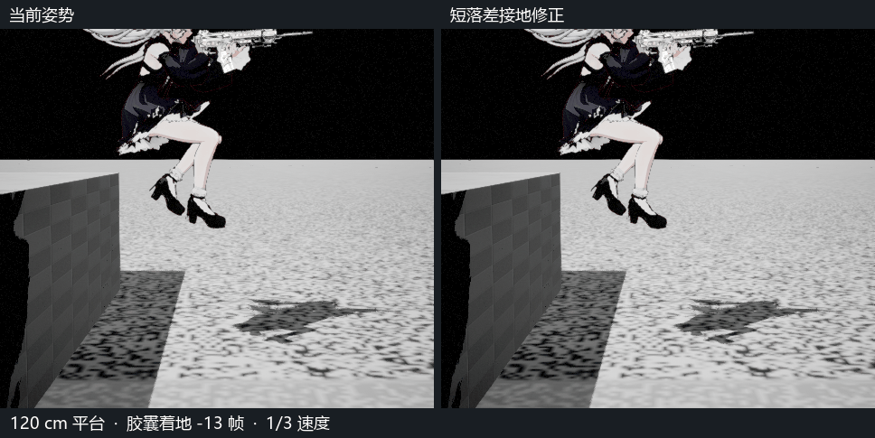

# Iris 从短台沿落地时，脚怎样承重、双手怎样持枪

[角色与战斗进度](../CombatProgress.md) / [为什么会悬脚](ShortFallContact.md)

在 120 cm 平台上，Iris 持步枪肩射向前走出。胶囊落地时，原姿势的最低鞋底还高出地面 **41.15 cm**。开启短落差接地修正后，右前掌在落地前一帧离地 **0.30 cm**，落地当帧与地面的高度差小于 **0.01 cm**。落地后 100 ms 内，该前掌相对着地点的最大水平位移为 **0.68 cm**。主动画继续按原来的状态和时序推进。

## 为什么伸直腿还不够

同一帧，右侧大腿根离地 109.64 cm，大腿加小腿长 83.10 cm。保持当前鞋尖角度，最低鞋底比脚踝低 15.51 cm。即使整条腿垂直伸直，仍会剩下 **11.03 cm**。直接把脚踝目标设在地上，双骨 IK 也无法在原髋位抵达。

| 120 cm，60 Hz，同一肩射输入 | 触地当帧最低鞋底 | 当帧姿势的代价 |
| --- | ---: | --- |
| 项目原姿势 | +41.15 cm | 胶囊已进入 Walking，双腿仍收在空中 |
| 踏空直接改为整身落地姿势，并提供当帧距地 | −0.71 cm | GameLevel 电车站的实际枪口最多偏离原轨迹 33.19 cm |
| 只求解双腿，原骨盆固定 | +14.54 cm | 保住持枪和骨盆，前掌仍够不到地 |
| 双腿与髋部配合，双手补偿 | 约 0 cm | 前掌到地，接下来 100 ms 内水平位移仍达 10.54 cm |
| 再固定承重点，并让鞋跟逐渐落下 | **约 0 cm** | 同一前掌的水平位移降至 **0.68 cm**，双腕及实际枪口与原轨迹一致 |

最后一组在落地当帧额外降低骨盆 **14.58 cm**。胸颈随髋部缓冲，双臂相应改变肘部角度，使双腕保持原来的位置和朝向。前掌先承重，鞋跟从第 0 帧高出 5.85 cm，到第 +5 帧也接近地面。观察肩射画面时，可以同时看鞋跟有没有落下来、枪身有没有被躯干带低。[整身候选的对照实验](ShortFallContact.md)

## 如何试用

在控制台输入 `tps.IrisShortFallReach 1` 开启，输入 `tps.IrisShortFallReach 0` 返回原姿势。当前默认值为 **0**。本次保留了电车站已有的默认姿势，新版可以独立对照。Iris 动画蓝图类默认值的 **Foot Contact → Short Fall Settings** 集中控制探测时间、落地预备、承重时间、释放时间、髋部最大降幅与摆动脚间隙。

1. **踏空时判断能否迈到下层。** 上一帧处于 Walking，这一帧进入 Falling，且角色处于肩射、没有向上起跳速度。用胶囊底到可行走面的距离、垂直速度和重力估算剩余时间。默认只接手进入 Falling 时预计 0.50 秒内能落地的踏空，在最后 0.21 秒逐渐伸腿。主动起跳和高台落地继续使用原动画。
2. **根据身体还能伸多远来降髋。** 用鞋跟和前掌估计剩余间隙，在腿长范围内把落地脚移向支撑面。腿够不到的部分由髋部下移承担。降幅还受两臂可达范围限制，避免为了够地把持枪手拉离原位。解算发生在 Iris 重定向姿势之后。
3. **接触后保留一个可追踪的承重点。** 记住支撑脚最先接地的鞋底测点，以及它在支撑物局部空间的位置。按地面法线让鞋底逐渐放平，默认承重 0.10 秒，再用 0.13 秒把控制交回原步态。实际碰撞与最终相机都由已有系统驱动。[短落差求解](../../Source/TPSCPP/Animation/IrisLandingPose.cpp) · [可调参数](../../Source/TPSCPP/Animation/IrisAnimInstance.h)

## 对战地图与复测口径

在 GameLevel 的 55 cm 武器标记台从东西两侧肩射走下，全程处于 Walking。主机与客户端操作者各走三次，鞋底、骨盆、胶囊、最终相机与实际枪口轨迹均与关闭时一致。78.44 cm 电车站侧沿则会触发短落差修正。两端都是第 120 帧离地、第 141 帧落地，最低鞋底从高出 36.74 cm 变为高出 **0.18 cm**。胶囊、镜头和实际枪口保住了原轨迹，髋部与关闭时的最大位置差约 **11.52 cm**。[GameLevel 双端逐帧数据](ShortFallGripGameLevel.csv)

| 其它走法 | 触地帧鞋底间隙 | 随后 100 ms 同一承重点的最大水平位移 |
| --- | ---: | ---: |
| 标准 120 cm，30 / 60 / 120 Hz | +1.02 / 约 0 / 约 0 cm | 2.29 / 0.68 / 0.19 cm |
| 60 Hz，横向 / 倒退走下 120 cm | 均约 0 cm | 2.06 / 1.87 cm |
| 从短台踏落至 10° 上坡 / 下坡 | +1.33 / −0.58 cm | 0.68 / 0.50 cm |
| 落地前反向 / 松开移动 | 均约 0 cm | 0.56 / 1.10 cm |

三档帧率还复测了主动起跳、320 cm 高台和高台踏落至 15° 上坡面，这些路线的着地鞋底间隙与原姿势一致。

固定 60 Hz 的标准路线从 3 m 宽平台中心起步，肩射以 150 cm/s 直行。第 0 帧取移动模式首次从 Falling 切回 Walking。距离单位为 cm，鞋底间隙沿世界竖直方向，分别在左后跟、左前掌、右后跟、右前掌的 XY 位置查地。正值为离地，负值为穿入。CSV 的 `course / flat120` 对应本页开头的动作。`off` 为原姿势，`legs_only` 只改两腿，`pelvis` 加入髋部与双手补偿，`plant` 为完整候选。[各路线的逐帧数据](ShortFallGripFrames.csv)

## 伸腿途中松开肩射会怎样

现在以**踏空时**的瞄准状态决定这一脚是否启用接地。肩射踏空后，玩家可以松键、切换 ADS 或重新按下肩射。镜头、视野与持枪姿势响应新输入，已经开始的落地和承重继续完成。若在台面上已松键，再以腰射走出台沿，这一脚仍沿用腰射动画。

以下在 120 cm 平台以 60 Hz 重放相同输入，两组均开启短落差开关。旧版在退出肩射时开始释放腿部修正。表中前掌位移取同一承重点着地后 100 ms 内的最大水平距离。

| 松开或切换的时机 | 触地帧鞋底间隙，旧 → 新 | 承重点水平位移，旧 → 新 |
| --- | ---: | ---: |
| 触地前 24 帧松开肩射 | 40.95 → 约 0 cm | 26.36 → 0.70 cm |
| 触地前 4 帧松开肩射 | 33.35 → 约 0 cm | 26.52 → 0.67 cm |
| 触地前 1 帧松开肩射 | 3.85 → 约 0 cm | 17.83 → 0.67 cm |
| 触地后 3 帧松开肩射 | 两组均约 0 cm | 9.61 → 0.53 cm |
| 触地前 4 帧从肩射切到 ADS | 34.33 → 约 0 cm | 5.01 → 0.61 cm |

在 GameLevel 的 78.44 cm 电车站，触地前松开肩射时，主机的落地悬脚从 35.70 降至 0.18 cm，客户端操作者从 32.55 降至 0.18 cm。均在第 141 帧恢复 Walking。全部 17 组对照逐帧核对了胶囊、瞄准状态、相机位置与旋转、视野角、实际枪口位置与旋转，读数在记录精度内一致。ADS 切入后本机网格可能隐藏，该组的鞋底按骨骼网格姿势取样。[切换瞄准的逐帧对照](ShortFallAimChange.csv)

## 网络延迟下，对手看到哪一帧落地

监听主机走下电车站侧沿，另一台 PIE 客户端在侧面观察同一角色的模拟代理。每档网络各走 16 次，交替关闭、开启修正，再分为持续肩射和触地前松开肩射，每个表格单元取 4 次的中位数。第 0 帧用**观察端自己**从 Falling 恢复 Walking 的时刻对齐，鞋底高度取该端 Iris 网格测点及其绘制偏移。

| 观察条件 | 持续肩射，落地间隙关 → 开 | 触地前松开肩射，落地间隙关 → 开 |
| --- | ---: | ---: |
| 本机监听 PIE，无额外网络模拟 | 37.33 → 0.20 cm | 37.41 → 0.20 cm |
| 单向模拟 40–70 ms、2% 丢包 | 38.38 → 0.22 cm | 38.29 → 0.22 cm |

弱网松键组开启修正的四次，着地间隙在 0.20–1.97 cm，随后 100 ms 的承重点水平位移在 0.62–0.76 cm。两种输入合计八次，开启时最大间隙 2.07 cm。主机均在第 141 帧触地，弱网观察端最后一次切回 Walking 在第 142–144 帧。有一次关闭修正的试次在接地后又短暂进入 Falling，表中取最后一次落地，CSV 同时保留首次落地帧和切换次数。以上是监听主机移动、客户端观看这一条复制路径的结果。[32 次对手视角实测](ShortFallObserver.csv)
## 着地当帧开火，服务器如何结算

在 GameLevel 电车站的 78.44 cm 侧沿，监听主机和客户端分别持突击步枪走下台沿，向下层站定的另一名玩家射击。每位射手各测四枪，覆盖修正开关与持续肩射、触地前松键的四种组合。双人 PIE 使用正常射击输入和武器散布，未加入网络延迟或丢包。

| 射手 | 服务器落地帧 | 同帧生成子弹并命中 | 松键组开关修正后的发射点距离 |
| --- | ---: | ---: | ---: |
| 监听主机 | 141 | 4/4 | 0.003 cm |
| 客户端 | 142 | 4/4 | 0.012 cm |

8 发子弹的生成点都与服务器当帧的 `MuzzleFlash` 插槽重合，每次消耗 1 发弹药。散布保留了不同的命中部位，6 发各扣 20 生命，2 发命中头部各扣 40，开关修正时各出现一次头部命中。这组实测覆盖落地者作为射手时的开火结算。弱网数据见上一节的观察端接地测试。[逐发枪口、命中部位与生命值](ShortFallServerShots.csv)
