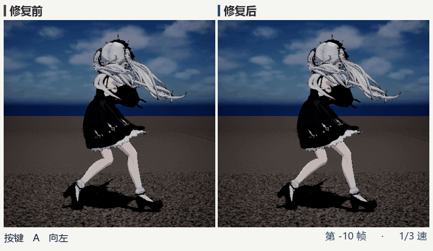
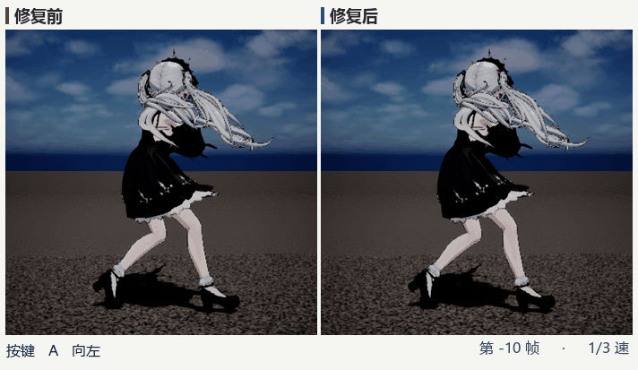

# Iris 持枪左右折返时，为什么脚会突然换到另一边？

Iris 肩射向左走，改按 D 并持续向右，通常能看到一个完整的刹步。如果刚按 D，又很快改回 A，右脚有时会在一帧内横跨身体。**两种操作都会触发同一个选片错误。第一次出错时，画面还以原来的步态为主；第二次出错时，折返动作已经占了画面的大半。**

## 先看脚，再看按键

两段动图都来自 GameLevel 中的实际游戏画面。左边使用修复前备份的两个动画蓝图，右边使用修复后的项目资产。Iris 持同一把步枪，肩射速度为 150 cm/s。两边均以 60 Hz 执行同一组输入，摄像机以相同角度和距离跟随角色胶囊。动图按三分之一速度播放，每个画面对应一个游戏帧。底部按键显示该帧送入的输入，第 0 帧为第一次 A→D。

**连续折返。** 先盯住左图的右靴。第 8 帧已经再次按 A，第 10 帧右脚还伸在画面左侧，第 11 帧它就到了身体右侧。右图在同一时刻开始把脚收回来，能看清中间的过程。



**单次折返。** 这次只从 A 换到 D，然后一直按住 D。左右两边都能看见制动和迈步。修复前也有一帧选错了动作，只凭画面很难认出它。



## 为什么横移会挑中一个后退动作？

持枪随镜头朝向时，角色面朝前方，可以左右横移。改按反方向后，胶囊要先减速，再向另一侧加速。动画蓝图用一段表现刹步和蹬地的动画来配合这次变向，这个状态叫 **Pivot**。它需要同时回答两个问题。选片决定刹步方向，选帧决定双脚从什么姿势开始制动。

先看选片。主动画蓝图会把上一帧的方向和当前加速度的单位方向各取一半，再把结果归一化。平常略微转向，两个箭头的中点还指向一个合理方向。可当玩家从向右改为向左时，横轴上的计算如下。

```text
上一帧向右（+1）× 0.5 + 当前向左（−1）× 0.5 = 0
```

零向量已经没有方向。原图仍把它送进角度分类，得到 0°，先归为前向，再经 `GetOppositeCardinalDirection` 取反，最后挑中了 `Walk_Bwd_Pivot`。一帧后方向恢复，入口后 0.20 秒内允许重新选片，于是求值器又换回侧向片段。这里的“后退”只描述动画资产，角色胶囊一直在做左右移动。

第二个问题让错误变得可见。**距离匹配**会根据角色还要滑行多远才刹住，在当前片段中找到相应姿势。相同的剩余制动距离，在后退和侧向两段动画里可能对应完全不同的脚位。实测第 10 帧取的是后退片段的 0.299 秒，第 11 帧取的是侧向片段的 0.491 秒。它们属于两段不同的动画，右靴横向位置从胶囊一侧的 −39.9 cm 到了另一侧的 +23.5 cm。

## 为什么单次不显眼，反复折返就很明显？

可以把状态权重理解成“这一帧的姿势有多少来自折返动作”。还要分清两层权重。外层决定原步态与 Pivot 各占多少。内层的 **Pivot A 和 Pivot B** 是两个可交替接管的播放分支，方便上一次折返还没结束时接受下一次。A/B 与键盘的 A/D、角色的左右脚都没有一一对应关系。

| 同一组肩射输入 | 当帧蓝图在做什么 | 屏幕上为什么不同 |
| --- | --- | --- |
| 第 0 帧 A→D，第 2 帧首次进入 Pivot A | 错选后退片段。外层 Pivot 权重只有 **1.27%**，原来的 Start 步态仍占 98.73% | 几乎整个姿势还由来步决定。第 3 帧换回正确片段时，Pivot 也才占 4.86% |
| 持续按 D | 此后方向稳定，侧向片段沿自己的制动、蹬地过程推进 | 没有第二次打断。整段双踝单帧位移峰值为 **8.4 cm** |
| 改为第 8 帧再按 A | 第 10 帧内层由 B 接管，再次错选后退片段。此时外层 Pivot 已占 **64.8%**。第 11 帧换回侧向时已占 **74.1%** | 旧步态只剩少量权重，难以掩住两段动画的脚位差。第 11 帧右踝三维位移达到 **63.9 cm** |

原来的 A/B 切换已经配置了 0.40 秒惯性混合。但状态切换后，新分支可以在下一帧再次换片，距离匹配也会重新选取姿势。仅把方向修正到不再选错后退片段，8 帧换向的肩射踝部峰值仍有 **34.0 cm**。这说明还得处理另一个问题。**即使两个侧向片段都选对了，上一次尚未迈完的腿，也要能自然地接到下一段。**

## 怎么修复？

### 1. 方向相消时，采用玩家这一帧的有效输入

在主动画蓝图的 `UpdateAccelerationData` 中，先检查两个方向的中点，再决定怎样归一化。若中点各分量的绝对值均不超过 **0.12**，直接选当前加速度的单位方向。其余情况沿用平滑后的方向。于是真正的反打可以在这一帧选对侧向片段，略带夹角的反打也能命中这条规则。若玩家只是松键，原来的单位方向与零输入取中点后仍有一半长度，归一化后仍指向原方向。[主动画蓝图](../../Content/Characters/Heroes/Mannequin/Animations/ABP_Mannequin_Base.uasset)

### 2. 从屏幕上已经显示的姿势接下一步

在共享物品层的 `FullBody_PivotState` 中，把 `Dead Blending` 放在 `PivotSM` 输出之后、混入持枪上身之前。这样 A→B 或 B→A 都经过同一处。换向时，新分支立即按当前制动距离求出目标姿势。混合节点从上一刻已经显示的姿势出发，让骨骼沿原来的速度再走一小段，同时衰减这部分速度，逐渐交给新姿势。如果中途又反向，就从此刻画面中的姿势接下去。[共享物品动画层](../../Content/Characters/Heroes/Mannequin/Animations/LinkedLayers/ABP_ItemAnimLayersBase.uasset)

项目采用 **0.30 秒线性混合**，骨骼外推速度的最大半衰期设为 **0.09 秒**。两个数字管的是不同的事。前者规定姿势交接的时间，后者限制旧动作的速度能延续多久。玩家可以在这 0.30 秒内继续换键。移动组件照常处理输入，两次测试的 1,455 个主机操作者样本中，改前改后的胶囊速度、高度和角色偏航角逐帧一致。

## 怎么判断修对了？

先看选片，再看脚。修复后，主机和客户端轮流操作，纯侧移时活动求值器误入后退片段的次数都为 **0**。然后比较两踝相对胶囊的单帧三维位移，取较大值，再取整段峰值。这个指标能抓出动图里的突然换位，包含摆动脚。判断贴地滑脚还需要知道鞋底何时承重。

| 肩射输入 | 修复前 | 修复后 |
| --- | ---: | ---: |
| 单次换向后持续按住 | 8.4 cm | 6.5 cm |
| 每 4 帧换向 | 29.4 cm | 6.6 cm |
| 每 8 帧换向 | 63.9 cm | 6.6 cm |
| 每 16 帧换向 | 17.1 cm | 9.0 cm |

以最容易看出问题的 8 帧换向为例，修复后的连续折返与单次折返已经在同一量级。客户端操作、主机观察时测得 **7.2 cm**。腰射、ADS、短起步后立即反向，以及按住 W 再交替 A/D 的对照也有单独记录。[完整双端实测与逐帧轨迹](LandingAndShoulderTests.md#连续侧移折返的正式修复)
