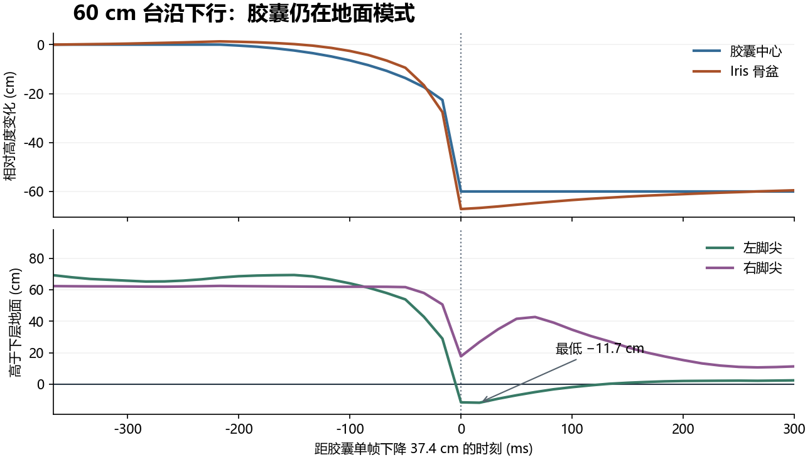
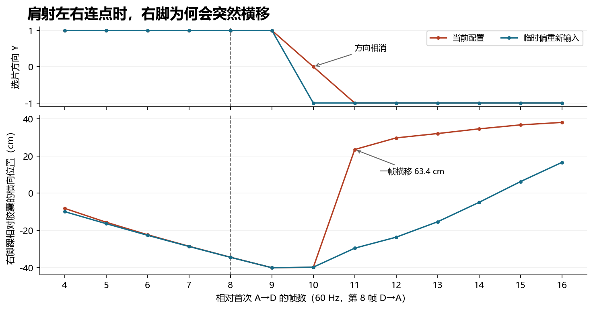
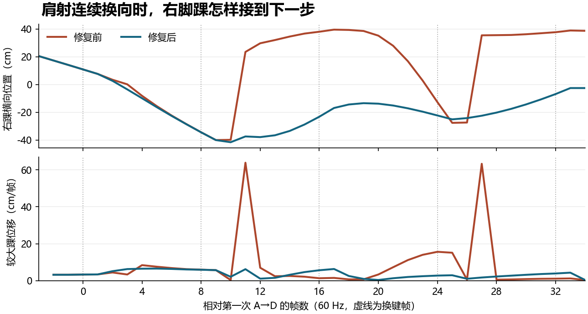

# Iris 走下台沿、落地预备与肩射换脚

[基础移动品质评估](LocomotionQuality.md) / [移动过渡](LocomotionTransitions.md)

**60 cm 临时台沿暴露了行走时的单帧贴地下坠。** Iris 以 150 cm/s 肩射走下时，胶囊在一帧内下降 37.4 cm，骨盆跟着下降 39.6 cm，左脚尖随后低于下层地面约 12 cm。GameLevel 的 55 cm 原有台沿已复现，支撑从上沿换到下层时，引擎在一帧内校正余下的 30.96 cm。[实际点位、逐帧轨迹与引擎日志对照](GameLevelLedge.md)

## 台沿和高处落地需要分别验收

### 玩家镜头怎样表现真正的落地

**原地跳没有下沉时，先查震动蓝图的两个子层。** 曾复现点击 Compile 并保存后，`Child Patterns` 仍有两项，但两项都变为 `None`。这时即使正常触发落地事件也没有镜头位移。修复后的下沉和余震对象由震动蓝图的类默认对象持有，组合模式引用它们。验证时连续编译两次、保存并在新进程重开，再用空格原地跳。空手和持枪腰射均在触地后第 5 帧下沉约 4.98 cm，第 14 帧回到原高度。[空手原地跳修复前后对比](LandingJumpRepair.mp4)

落地当帧，腰射或肩射玩家的相机沿世界 Z 轴下沉一次，叠加一段更小的竖直震动。强度取落地前的下降速度，与角色朝向无关。镜头保持原来的朝向和视野角。ADS 落地保留原镜头，55 cm 台沿走已有的贴地平滑。[电车站玩家镜头：原速和慢放](LandingCameraComparison.mp4)

| GameLevel，60 Hz | 相对原镜头的最大额外下沉 |
| --- | ---: |
| 从 78.44 cm 电车站侧沿腰射跑下 | 2.62 cm |
| 从同一侧沿肩射走下 | 2.83 cm |
| 在平地原地跳起后落地 | 4.98 cm |
| 肩射走下 55 cm 武器标记台 | 0 cm |
| ADS 走下电车站侧沿 | 0 cm |

监听主机和客户端分别操作同一路线，两端结果取到 0.01 cm 一致。每条路线各在改前和改后运行一次。三组触发样本在触地后第 5 帧达到最大下沉，第 14 帧回到原镜头高度（约 0.23 秒）。两版的胶囊轨迹、速度、相机水平位置和 FOV 逐帧相同。武器使用镜头中心反投影取瞄准线，额外位移会移动这条线的起点。

**在编辑器里调。** 打开 `BP_CameraShake_Landing` 的 Class Defaults，展开 Root Shake Pattern 的两个子层。第一层 `Compression` 控制主下沉，Z Amplitude 为 −5 cm，Duration 为 0.24 秒，Frequency 为 2.083 Hz；半个正弦周期刚好压下再回正。要调深浅，先改振幅；要改时长，频率对应设为 `0.5 / Duration`。第二层 `Vibration` 的 Z Amplitude 为 −0.45 cm、Frequency 为 13 Hz，持续 0.18 秒；只想减轻余震时调小这一层的振幅。两个子层都从零相位起步。[镜头震动资产](../../Content/Blueprints/Camera/BP_CameraShake_Landing.uasset)

还可以在 `BP_ThirdPersonCharacter → Class Defaults → Camera → Landing` 调 `Landing Speed Range`。X 是开始有反馈的下降速度（120 cm/s），Y 是达到满幅的速度（520 cm/s，应大于 X）。中间线性插值。落地使用拥有者的本地 GameplayCue，监听主机和客户端各自驱动自己的相机。[角色蓝图](../../Content/Blueprints/Character/BP_ThirdPersonCharacter.uasset) · [落地入口](../../Source/TPSCPP/Character/TPSCPPCharacterLanding.cpp)

### 台沿与角色动作

120 cm 短落差现已有独立的鞋底与状态机测量。胶囊触地时，默认姿势的最低鞋底仍离地 41.15 cm。不同转场和距地采样时机的效果，以及实际电车站发现的枪口偏移，见[短落差悬脚的成因与候选对照](ShortFallContact.md)。

55 cm 实际台沿现已接入肩射表现平滑，下图保留临时平台上的原始诊断。平滑前后的骨盆和相机轨迹见[同一实景路线对照](ShoulderLedgeSmoothing.md)。

**走下 60 cm 台沿。** 从上层平地以稳定速度正向走出。胶囊先逐渐降下，到图中零点前一帧下降 5.2 cm，下一帧下降 37.4 cm 并到达下层站立高度。左脚尖骨连续 8 帧低于下层平面，最低 −11.7 cm。对照运行中两次都未进入 Falling。以成熟第三人称动作游戏的地面接触表现来验收，这里需要同时看高处支撑脚何时卸重、低处脚何时接地，以及两次接触之间骨盆如何下降。单调落地片段无法覆盖全程处于地面模式的这一步。

**稳定步行也能复现。** 将平台宽度从 3 m 增至 9 m，从中心起步，给肩射动画足够时间由 `Start` 进入 `Cycle`。走下相同高度时，胶囊仍在一帧下降 37.4 cm；同一帧 Quinn 骨盆下降 39.7 cm、可见 Iris 骨盆下降 39.7 cm，玩家相机位置下降 **20.8 cm**。脚尖连续 8 帧低于下层平面，最低 −10.4 cm。胶囊和源骨架已经有这次下坠，下一次定位应从支撑面切换开始，再分别看重定向和镜头对它的响应。

**原地跳、平地和坡面踏落。** 以固定 60 Hz 重放同一输入。A 用项目默认动画，B 在临时实例处于 Falling 时提供胶囊底至脚下碰撞面的竖直距离。两组逐帧胶囊位置相同。表中素材时间取落地前 6 帧（100 ms）的 `FullBody_FallLandState` 序列求值器，脚尖差取空中同帧左右对应骨点之间的最大三维距离。

| 动作 | 空中帧数 | 默认 → 提供距离后的素材时间 | 可见 Iris 脚尖最大差异 |
| --- | ---: | ---: | ---: |
| 原地跳，落回平地 | 61 | 0.400 → 0.309 s | 5.1 cm |
| 走下 120 cm 平台，落到平地 | 28 | 0.400 → 0.400 s | 小于 0.1 cm |
| 走下 320 cm 平台，落到平地 | 47 | 0.400 → 0.247 s | 7.4 cm |
| 从高台向前踏落至 15° 上坡面 | 46 | 0.400 → 0.244 s | 6.6 cm |

高台踏落时，输入距离后，平地样本在触地前 200、100、33 ms 依次读到求值器的 0.131、0.247、0.333 s；坡面对应为 0.122、0.244、0.333 s。项目默认在这些帧都读到 0.400 s。状态机复测中，两组高台分别在触地前 13 帧和 12 帧进入 `FallLand`。坡面距离取胶囊中心正下方的竖直射线；移动平台和两脚踏在不同高度的情形另需验证。

**120 cm 为什么没有改善？** 对提供地面距离的一组加录状态机，走出台沿进入 `JumpApex`，28 帧后触地，直接回到 `Cycle`。这次动作没有经过 `FallLoop` 或 `FallLand`，所以表里的 0.400 s 是未激活求值器保留的读数。原地跳和两种高台都实际进入了 `FallLand`。正式接入地面距离后，短落差还要单独验收状态是否有机会切入落地预备。

## 肩射的 Stop 和 Pivot 怎样对照

全部使用同一把突击步枪、同一肩射状态和 150 cm/s 限速。基线沿用现有 Rifle Walk 起步与循环、Jog Stop 和 Jog Pivot。第一组分别在独立 PIE 进程临时替换 Stop 或 Pivot 的四方向素材；读取正在推进的序列求值器核实选中的 Jog／Walk 片段。没有切到 ADS。所有测量都取可见的 Iris 网格。

**急停。** 松键后，以静止末段的双脚尖位置为参考，记录双脚都进入容差且持续到窗口结束的首帧。位置容差对视觉判断很重要：向右移动 2.00 s 后松键，Jog 进入 3 cm 范围用了 32 帧，Walk 用了 21 帧；但 Walk 在接近站姿后还保留约 2.9 cm 的偏差。若收紧至 2 cm，结果变为 Jog 33 帧、Walk 83 帧。后者不能解读为角色多滑行了 50 帧，这两个样本的胶囊都在 8 帧（133 ms）内停稳。

**180° 反打。** 持续移动后在同一帧完全反向，四向基线和 Walk 候选都用 13 帧（217 ms）达到反方向 149 cm/s。比较换脚时，取反向后前 28 帧：单只脚尖距地 ≤6 cm 且连续至少 4 帧，在这段时间取其世界水平位置间的最大距离，再取两脚中较大值。这个量能筛查低位横移大的镜头；只有结合脚掌和脚跟的接触，才能区分承重脚滑动与正常的脚掌滚动。

为检查步态相位的影响，第二组把按下移动的时刻推迟 18 帧，松键或反向的时刻保持固定。两组分别持续输入 2.00 s 和 1.70 s。第二组候选同时配置 Walk Stop 与 Walk Pivot；直行松键取 Stop 数据，反打只取松键前的 Pivot 窗口。逐一核对了四方向实际推进的素材，各对应基线与候选在事件前 6 帧及事件帧的脚尖相对胶囊位置相差最多 0.02 cm，胶囊水平轨迹相同。

| 直行后松键 | 2.00 s 输入，站稳帧数 Jog → Walk | 1.70 s 输入，站稳帧数 Jog → Walk |
| --- | ---: | ---: |
| 前进 | 28 → 8 | 28 → 8 |
| 向右 | 33 → 83 | 33 → 83 |
| 后退 | 14 → 14 | 12 → 14 |
| 向左 | 30 → 15 | 30 → 13 |

表中使用 2 cm 容差。若要先挑一段动作看画面，优先看前进 Walk Stop：两次都让双脚提前 20 帧（333 ms）回到最终站姿，且与胶囊停住落在同一帧。随后应看这段快速收步是否保留了足够的卸重感。向右则应单看最后约 3 cm 的站姿混合。

| 反向输入 | 2.00 s 输入，低位脚尖水平跨度 Jog → Walk（cm） | 1.70 s 输入，同指标（cm） |
| --- | ---: | ---: |
| 前进切后退 | 41.1 → 30.2 | 42.7 → 24.9 |
| 向右切向左 | 36.2 → 49.1 | 59.8 → 53.2 |
| 后退切前进 | 7.0 → 55.0 | 59.1 → 27.1 |
| 向左切向右 | 9.8 → 37.7 | 26.5 → 16.9 |

对退步后立刻前压的玩家，同一段 Walk Pivot 在两种输入时机出现相反结果。要让反打在任意松键时机都显得有重量，下一步应该把进入 Pivot 的承重脚与片段第一步对齐，在玩家视角逐帧看脚跟离地和另一脚接地。早期对照保留了四向 Jog Pivot；站立肩射的正式选片已在下节修正。上表仍可用来检查不同来步时机的脚部接触。

### 肩射折返为何短暂出现跑姿

站立步枪肩射的 `SetUpStartAnim` 和 `UpdateCycleAnim` 已使用 `UseShoulderWalkCycle`，而 `GetDesiredPivotSequence` 原先只检查 ADS。GameLevel 基线中，按住前进再切后退、后退切前进、左右互切，四组都在 Shoulder 状态下推进了对应的 Rifle Jog Pivot。胶囊最高速度为 150 cm/s，冲刺标记始终关闭。

共享物品层现用与起步、循环相同的判断：ADS 或步枪层的肩射步态标记成立时，选择对应方向的 Walk Pivot。蹲伏仍由外层选择器优先处理。Pivot 入口及状态内根据方向重新选片都调用同一函数。

GameLevel 固定 60 Hz 双人监听服，主机、客户端轮流操作，从右键按住进入肩射，分别测试 W→S、S→W、A→D、D→A。按求值器时间是否逐帧推进确认实际片段。四组在操作者和观察者上均使用对应的 `MM_Rifle_Walk_*_Pivot`，全程保持 Shoulder，最高速度 150 cm/s。松开长按后腰射前后折返使用 Jog Pivot，最高 300 cm/s；短按进入 ADS 后同方向折返使用 Walk Pivot，最高 150 cm/s。

### 持枪随镜头朝向时连续按 A/D 的跳变

GameLevel 平地固定镜头，60 Hz 双人监听服，主机和客户端轮流操作。先仅按 A 持续侧移，再每 8 帧同时松开一侧、按下另一侧，共反向七次。腰射使用 Jog Pivot，肩射与 ADS 使用 Walk Pivot。三种状态都能重现。胶囊高度与角色朝向在这个窗口内恒定。按住 W 再交替 A/D 的对照走 Start/Cycle，肩射踝部单帧位移峰值为 4.8 cm。

**跳变发生在哪一帧。** 以下以第一次 A→D 为第 0 帧。肩射在第 8 帧 D→A，第 10 帧实际加速度已向左，`PivotDirection2D` 却从向右变成零向量。Pivot B 取了 `Walk_Bwd_Pivot` 的 0.299 s；第 11 帧方向变为向左，同一求值器换为 `Walk_Right_Pivot` 的 0.491 s。此时右脚踝相对胶囊单帧移动 63.9 cm，其中横向 63.4 cm，骨盆单帧下降 6.9 cm。Quinn 源网格同帧也有约 65 cm 的脚部位移。客户端操控时，主机观察到的峰值为 64.2 cm，晚一帧出现。

**为什么横移会选到后退。** 主动画蓝图的 `UpdateAccelerationData` 将上一帧的回转方向与当前加速度单位方向按 0.5 插值，再归一化。两个方向完全相反时中点为零。这个值被换算为 0°，分类为前向，再经 `GetOppositeCardinalDirection` 得到后退片段。新分支的 `SetUpPivotAnim` 和随后的 `UpdatePivotAnim` 读取同一方向变量。入口后的 0.20 s 内允许重新选片，所以一帧后又会换回侧向片段。A/B 过渡本身使用 0.40 s 惯性混合；状态权重立即切到新分支，实际呈现还取决于惯性化与距离匹配。

**隔离对照。** 仅在独立 PIE 进程里把新方向权重从 0.50 改为 0.51，再单独将 A/B 从惯性混合切为同样 0.40 s 的普通交叉淡化。下表是操作者样本，两只踝相对胶囊的单帧三维位移取较大值，再取整段峰值（cm），包括摆动脚。

| 步态与换键间隔 | 修复前资产 | 临时消除零方向 | 再改为普通交叉淡化 |
| --- | ---: | ---: | ---: |
| 腰射，8 帧 | 28.8 | 12.1 | 23.4 |
| 肩射，8 帧 | 63.9 | 34.0 | 15.4 |
| 肩射，4 帧 | 29.4 | 41.6 | 37.4 |
| 肩射，16 帧 | 17.1 | 17.3 | 31.1 |

消除零方向后，纯侧移的活动分支不再短暂进入后退片段。剩余峰值出现在左右片段交接附近，例如 4 帧一换时右脚仍能在 B 接管当帧移动 41.6 cm。这组隔离实验用于区分方向错选和正确片段之间的接步跳变。

### 连续侧移折返的正式修复

首次折返和连续折返的实录、逐帧权重及修复接线见[图解：Iris 持枪左右折返](IrisStrafePivot.md)。主动画蓝图在归一化之前检查新旧方向的中点。如果各分量的绝对值均不超过 0.12，直接取当帧加速度单位方向；其余情况使用原先平滑后的单位方向。松开移动键时，有效旧方向与零输入的中点仍能归一化为旧方向。原生 Lyra 的侧移复现也经过这个相消点。

共享物品动画层在 `FullBody_PivotState` 把 `PivotSM` 的输出先接入 `Dead Blending`，再混入持枪上身。再次反向时，新分支当帧开始按制动距离求值，局部混合节点从上一段已经显示的姿势和骨骼速度衔接过去。节点统一采用 0.30 s 线性混合，外推速度的最大半衰期为 0.09 s。4 帧一次的输入可以在前一次混合结束前再次换脚。调接步应从这个共享节点入手。

重新载入已保存的资产，在 GameLevel 固定 60 Hz，用突击步枪分别由监听主机和客户端操控。每格是 Iris 两踝中较大的单帧三维位移峰值 / 骨盆单帧竖直位移峰值，单位 cm，均相对胶囊。两项峰值可出现在不同帧。

| 操作者输入 | 改前主机自视 | 改后主机自视 | 改后客户端操作、主机观察 |
| --- | ---: | ---: | ---: |
| 腰射，每 4 帧 | 19.5 / 5.2 | 11.3 / 1.5 | 12.5 / 1.5 |
| 腰射，每 8 帧 | 28.8 / 10.0 | 11.3 / 1.4 | 12.5 / 1.4 |
| 腰射，每 16 帧 | 13.6 / 2.0 | 11.3 / 1.4 | 12.5 / 1.4 |
| 肩射，每 4 帧 | 29.4 / 5.0 | 6.6 / 0.5 | 7.2 / 0.5 |
| 肩射，每 8 帧 | 63.9 / 7.6 | 6.6 / 0.6 | 7.2 / 0.6 |
| 肩射，每 16 帧 | 17.1 / 1.6 | 9.0 / 0.6 | 9.5 / 0.6 |
| ADS，每 4 帧 | 56.8 / 3.6 | 6.6 / 0.5 | 7.2 / 0.5 |
| ADS，每 8 帧 | 63.9 / 7.6 | 6.6 / 0.6 | 7.2 / 0.6 |
| ADS，每 16 帧 | 17.1 / 1.6 | 9.0 / 0.6 | 9.5 / 0.6 |
| 肩射，只起步 8 帧就开始折返 | 85.2 / 5.7 | 7.8 / 1.2 | 8.2 / 1.2 |

主机操作者的 17 组输入共抽取 1455 帧，逐帧比较改前与改后的胶囊速度、高度和角色偏航角，记录值全部一致。

单次左右折返时，腰射、肩射、ADS 的操作者脚踝峰值分别由 13.4、8.4、8.4 cm 降至 12.3、6.5、6.6 cm。按住 W 交替 A/D 时，腰射和肩射仍为 7.7、4.8 cm。ADS 单次 W→S 的骨盆峰值维持 1.1 cm。

修复后的左右折返在两轮操作者和观察者记录中，活动求值器误进后退片段的次数均为 0。客户端另测镜头偏转 ±8° 后继续换向，仍选择侧向片段。测量包含摆动脚，不能将单帧踝位移直接当作贴地滑脚距离。

## 取样条件

2026-11-26，本机 UE 5.8，无渲染双人监听服 PIE，测量主机持有的 Iris。项目 GameMode 正常生成角色，临时平地和台沿提供可量测的表面。动画对照只在诊断进程内生效。数值用于比较相同输入下的动作，没有对商业游戏设定统一的速度或滑步阈值。[项目移动设置](../../Source/TPSCPP/Character/TPSCPPCharacter.cpp) · [步枪动画层](../../Content/Characters/Heroes/Mannequin/Animations/Locomotion/Rifle/ABP_RifleAnimLayers.uasset)
