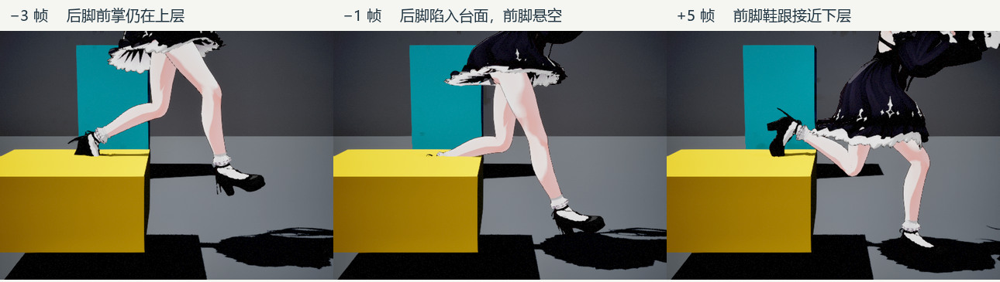
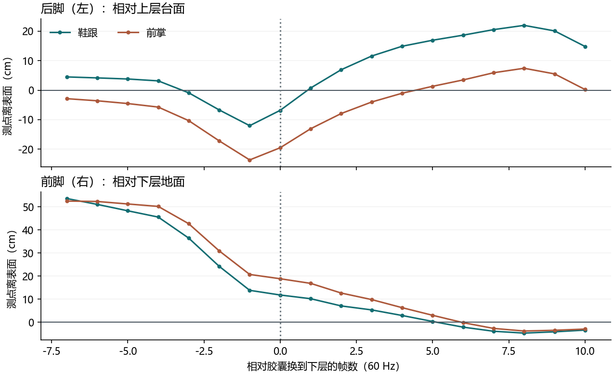

# 走下台沿时，两只脚怎样交接支撑

[肩射下台沿的改动](ShoulderLedgeSmoothing.md) / 鞋底与地面接触

本页保留足部修正前的诊断和四种试验。当前默认实现与改前改后实录见[支撑脚如何离开上层](IrisLedgeSupport.md)。

**最深的穿入发生在胶囊切到下层的前一帧。** Iris 从 55 cm 武器标记台向东走下时，后脚前掌的网格测点低于上层台面 **23.65 cm**，前脚鞋跟却还悬在下层上方 **13.86 cm**。两次向东、一次向西重放，后脚前掌最深穿入均在 23.62–23.74 cm。此前角色和镜头的平滑已经削弱了整体顿挫，这次能把剩余问题定位到具体哪只脚、哪一帧。

## 看一次迈步

下表以第一次向东走为例，第 0 帧是胶囊切换下层支撑。每个测点从自己的水平位置向下查地。单位 cm，负数表示测点进入表面以下。

| 相对帧 | 后脚鞋跟到上层 | 后脚前掌到上层 | 前脚鞋跟到下层 | 动作 |
| ---: | ---: | ---: | ---: | --- |
| −5 | +3.8 | −4.5 | +48.3 | 后跟抬起，前掌还留在上层 |
| −1 | −12.0 | **−23.7** | **+13.9** | 后脚已经陷入台面，前脚还够不到下层 |
| 0 | −6.8 | −19.5 | +11.8 | 胶囊贴地，身体开始收回表现补偿 |
| +5 | +16.9 | +1.3 | +0.4 | 后脚前掌离台，前脚鞋跟首次进入距地 1 cm 范围 |

第 −1 帧胶囊下降 **5.78 cm**，Quinn 骨盆下降 **9.74 cm**，Iris 骨盆下降 **9.82 cm**。扣掉胶囊运动，Iris 骨盆相对胶囊又降了 **4.05 cm**。项目当前的 `CR_Mannequin_FootPlant` 取左右脚目标偏移中的较小值作为骨盆弹簧的目标，再分别求解两条腿。前脚探到低处时，这条路径已经能把源骨架的骨盆向下带。仅放慢骨盆弹簧后，这一帧相对胶囊的下降量从 4.05 减到 1.50 cm，两条腿各自的接触误差仍然可见。[足部 Control Rig](../../Content/Characters/Heroes/Mannequin/Rig/CR_Mannequin_FootPlant.uasset)

## 四种候选改动的得失

同一把步枪、同一条东沿、同一段肩射输入。上一轮的身体与相机补偿全程开启。表内的后脚穿入取跨步过程中前掌测点仍在上层时的最深值；前脚接近下层取鞋跟首次距下层 ≤ 1 cm 的帧。达到这个距离只说明几何上接近，不能单凭它判定角色已经承重。

| 双脚求解方式 | 后脚前掌最深穿入 | 前脚接近下层 | 骨盆最大单帧下移 | 对照中看到的代价 |
| --- | ---: | ---: | ---: | --- |
| 当前版本 | 23.65 cm | +5 帧 | 9.82 cm | 上层前掌先沉入台面 |
| 切换到动画层 Foot Placement | 9.16 cm | +14 帧 | 6.06 cm | 第 0 帧骨盆向上弹了 **27.95 cm** |
| 放慢骨盆弹簧 | 16.42 cm | +5 帧 | 7.27 cm | 第 −1 帧前脚鞋跟离下层变为 21.96 cm |
| 加快两只脚的弹簧 | 16.02 cm | +7 帧 | 9.82 cm | 最深穿入推迟到 +10 帧 |
| 只加快需要向上修正的脚 | 15.52 cm | +6 帧 | 9.82 cm | 电车站下落与触地窗口内，鞋底测点偏离原轨迹最多 1.94 cm |

**当前保留已验证的肩射表现。** 四个候选都只在独立 PIE 进程中试跑。分脚调节把后脚最深穿入减少约 8 cm，平地稳定步行的四个鞋底测点与当前版本重合；它仍会影响电车站的脚部姿势。下一版应在上层前掌仍与台面接触时约束这只脚，前脚继续向下探，后脚跨出边缘后释放。验收时同时看上下两个方向的骨盆峰值，避免把突降换成上弹。

## 换一步走，同一台沿会怎样

改变角色距东沿的起步距离，让胶囊在迈步的不同阶段越沿。现版本从 30、70 cm 外起步时，上层前掌最深分别进入台面 14.3、15.3 cm。从仅 12 cm 外起步时，前掌已经越沿，后跟还搭在台边：第 +14 帧左鞋跟测点水平位置为 X = −60.43 cm，距东沿仅 0.43 cm，查到的表面仍高 55 cm，测点已低于它 36.44 cm。这里尤其需要记录鞋底还有多少面积与台面重叠；用最后一点鞋跟接触把整只脚锁在高处，会使离台显得过晚。

再从相同的 52 cm 起步点保持向 +X 移动，只把瞄准方向转 90° 或 180°。在支撑切换前后各 18 帧内，四个测点在上层的最深穿入分别为 **18.19 cm** 和 **3.39 cm**。后续验收应同时包含前掌仍承重、仅后跟与边缘重叠，以及侧移和倒退三类姿势。[步态变化逐帧数据，同表内 `current_phase` 组](LedgeFootContact.csv)

## 怎样复测

### 当前试作的设计

在 Iris 的最终动画姿势上，只修正仍压在静态上沿的腿。肩射 Walking 期间，胶囊仍由上层支撑、中心下方已能查到低处时，记录实际的上层碰撞面。先覆盖 12–65 cm 的层差，并按每只鞋的鞋跟与前掌重新查询上层覆盖比例。整只脚仍在台上时，以实际穿入量决定抬高多少；只剩鞋尖或鞋跟压边时，随覆盖比例降低权重。两段腿骨 IK 保持腿长与脚掌原有朝向，骨盆、另一只脚和持枪上身各自沿用原姿势。将当前身体绘制偏移算进鞋底高度，避免在支撑切换帧把同一段高度补两次。以同路线的穿入深度、离台后脚速和下层接触时刻验收，并对照平地与电车站整段轨迹。

### 取样口径

- **鞋底。** 取 Iris LOD0。对左右脚分别筛出首个蒙皮影响为踝或趾骨的顶点，沿参考姿势下踝到趾的水平轴分段，在最后 25% 和最前 25% 各选最低顶点。四个固定顶点按当前骨骼姿势蒙皮，并加上实际渲染代理的 Z 偏移。左跟、左前掌、右跟、右前掌的顶点索引依次为 26692、20296、26506、20446。四点用于比较同一双鞋，鞋底其他位置仍可能更深。
- **地面。** 从每个测点正上方、同时高于胶囊中心的位置向下投射，记录命中的关卡构件和世界高度。即使鞋已经穿过上层，这条射线也能读到上层台面。
- **设置。** `UseFootPlacement=true` 切换至动画层的 Foot Placement 路径。骨盆候选将主图弹簧强度 2.5 调为 1.6，目标速度权重 0.2 调为 0。双脚候选将 `ProcessFootOffset` 的弹簧强度从 2.5 调为 7。分脚候选把该脚目标相对骨盆的向上修正量 8–24 映射到弹簧强度 2.5–7，在区间外钳制。
- **取样。** UE 5.8、60 Hz、GameLevel 双人监听服，由主机操作。每种设置均走东沿两次、西沿一次、电车站侧沿一次、平地一次。CSV 中路线分别为 1–5，保留第 85–150 帧；电车站以第 120–141 帧复核下落与着地，平地以第 90–150 帧复核行走。相同路线的胶囊和相机轨迹已逐帧配对。[五种设置的鞋底与骨盆数据](LedgeFootContact.csv)
- **步态变化组。** `current_phase` 组路线 1–3 为从 12、30、70 cm 外向东起步，4、5 为侧移和倒退，保留第 62–150 帧。侧视实录另开进程采集，所示三帧的四个鞋底测点与第一次向东走测逐点重合。
