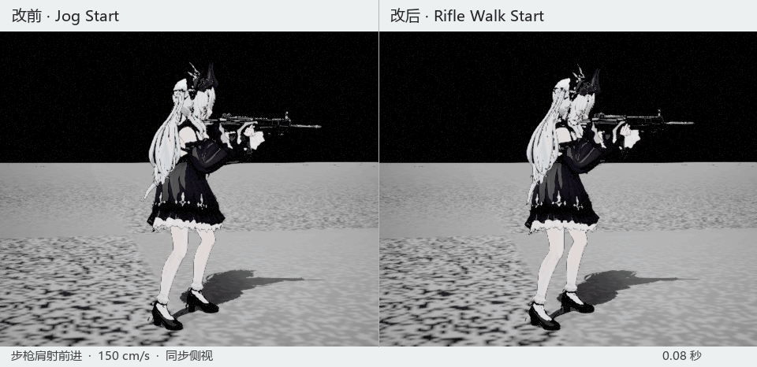
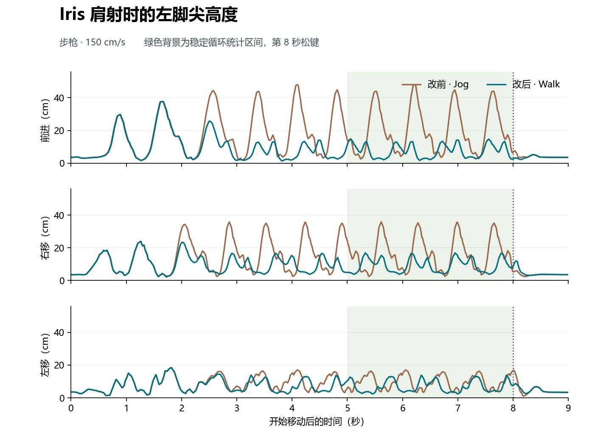

# Iris 基础移动与 3A 第三人称射击的差距

**Iris 的步枪肩射现在从 Rifle Walk Start 起步，再进入 Rifle Walk 循环。** 平地速度为 150 cm/s。前进头两秒的脚尖峰值从 37.7 cm 降到 15.7 cm。只点按四分之一秒时，两版脚尖本来就低，这时更值得看身体怎样换重心、松键后怎样收脚。

后续实测覆盖松键收脚、左右反打、高台踏落、横坡静止，以及主机和客户端交换观察视角。测量结果、落地对照图与处理优先级见[移动过渡与联机表现](LocomotionTransitions.md)。

## 肩射起步与短按探身

左边是上一轮已经使用 Rifle Walk 循环、仍用 Jog Start 起步的版本。右边从第一步开始就选 Walk Start。两边用相同的步枪、前进输入和跟随侧视相机，按相同游戏时间对齐。观察约 1.2 秒时的后腿，左侧鞋跟向后抬起，右侧后脚伸得更低，前脚已向前迈出。

| 方向 | 持续移动头 2 秒的脚尖峰值 | 按住 0.60 秒期间的脚尖峰值 | 点按 0.25 秒期间的脚尖峰值 |
| --- | ---: | ---: | ---: |
| 前进 | 37.7 → 15.7 cm | 13.3 → 10.9 cm | 4.0 → 3.7 cm |
| 右移 | 29.1 → 18.3 cm | 18.1 → 12.4 cm | 6.1 → 5.8 cm |
| 左移 | 18.5 → 13.6 cm | 9.5 → 13.6 cm | 3.7 → 4.0 cm |
| 后退 | 15.2 → 16.9 cm | 12.0 → 10.5 cm | 4.4 → 3.5 cm |

前进和右移改善最明显。左移按 0.60 秒时抬脚增加了 4.1 cm，但同期骨盆起伏从 15.4 cm 降到 11.1 cm。后退持续移动头两秒抬脚增加了 1.7 cm。步态品质还取决于承重、蹬地与持枪姿势，单个峰值只能回答脚抬了多高。

**复测口径。** 两版在独立 PIE 的同一水平地面，分别以固定朝向向四个方向持续移动 4 秒，再从静止做 0.25 秒与 0.60 秒点按。每格取该输入窗口内 Iris 两只脚尖骨相对地面的最高值。改后肩射可达 150 cm/s，各方向松键到速度低于 1 cm/s 需约 0.14 秒，制动距离约 7 cm。对照的腰射和 ADS 向前起步，头两秒的峰值分别为 38.6 cm 和约 15.8 cm，两版相差至多 0.1 cm。动图是单独在渲染 PIE 中采集的实时侧视画面。

**蓝图入口。** `SetUpStartAnim` 复用上一轮的 `UseShoulderWalkCycle` 标记。站立肩射按方向从 `ADS_Start_Cardinals` 取 `MM_Rifle_Walk_*_Start`，再由 `UpdateStartAnim` 按角色的实际位移推进。停止和反向转身仍有独立选片入口。核对短按表现时，应分别观察按下、松键和胶囊停稳三个时刻。[共享动画层](../../Content/Characters/Heroes/Mannequin/Animations/LinkedLayers/ABP_ItemAnimLayersBase.uasset) · [步枪方向素材](../../Content/Characters/Heroes/Mannequin/Animations/Locomotion/Rifle/)

**何时进入循环。** 单独重跑前进并以约 25 Hz 读取运行中的动画层。旧版起步求值器选中 `MM_Rifle_Jog_Fwd_Start`，新版选中 `MM_Rifle_Walk_Fwd_Start`。从开始给前进输入计时，循环播放器首次读到 `MM_Rifle_Walk_Fwd` 分别约为 2.01 秒和 2.04 秒，相差约一个采样间隔。这是循环首次参与求值的时间，完整混合结束还在其后。前两步的变化已经能由起步素材解释，因此保留原有切换规则。

## 上一轮对照：肩射稳定循环

两版各在独立 UE 5.8 无渲染 PIE 中运行相同输入。角色装备同一把突击步枪，面向固定方向，按前、右、左各移动 8 秒，每次松键后静止 2 秒。表中取每段最后 3 秒，两只脚尖世界高度取较高峰值并减去地面高度，骨盆起伏取 Iris 的 Hips 骨最高与最低之差。两版三个方向的实测水平速度均为 150 cm/s。

| 稳定肩射 | 双脚尖最高点，Jog → Walk | 骨盆起伏，Jog → Walk | 松键至停稳，Jog → Walk | 停止距离，Jog → Walk |
| --- | ---: | ---: | ---: | ---: |
| 前进 | 48.8 → 15.2 cm | 10.1 → 3.6 cm | 0.145 → 0.143 s | 6.89 → 6.92 cm |
| 右移 | 35.8 → 17.0 cm | 6.2 → 5.5 cm | 0.141 → 0.142 s | 6.89 → 6.78 cm |
| 左移 | 19.1 → 14.2 cm | 7.7 → 3.8 cm | 0.143 → 0.141 s | 6.82 → 6.88 cm |

前进的抬脚高度降低约 69%，右移约 53%，左移约 26%。原版左移本来就比右移抬脚低，换片后最明显的左移变化是骨盆起伏约减半。三段急停的胶囊距离差都在 0.11 cm 以内。按“两脚尖都进入最终静止位置的 2 cm 范围，并保持到松键后 1.5 秒”估计，前进、右移、左移的收脚时间改前约为 0.47、0.55、0.51 秒，改后约为 0.46、0.56、0.51 秒。每个方向各采一次，不宜把这一帧左右的差异解读为制动改善。

这轮只替换循环，前进起步后第 1 至第 2 秒，两版脚尖峰值都约 38 cm。上方的起步实验沿用同一个 Walk 循环，单独替换 Start，解释了早期几步的差异。

**选片与回归。** 步枪动画层在游戏线程读取持有者的瞄准状态，肩射时设置 `UseShoulderWalkCycle`。公用的 `UpdateCycleAnim` 在站立时由该标记或原有 ADS 标记选择方向 Walk。其他武器层的肩射标记默认关闭。实测退出肩射后腰射为 300 cm/s，双脚尖峰值约 49.5 cm；ADS 为 150 cm/s，峰值约 15.2 cm。两种对照状态的峰值与改前一致到 0.1 cm。文中曲线只画左脚，表格统计双脚。[步枪动画层](../../Content/Characters/Heroes/Mannequin/Animations/Locomotion/Rifle/ABP_RifleAnimLayers.uasset) · [共享循环](../../Content/Characters/Heroes/Mannequin/Animations/LinkedLayers/ABP_ItemAnimLayersBase.uasset)

## 一分钟了解现状

| 维度 | 当前完成度 | 面向本项目的成品目标 |
| --- | --- | --- |
| 操作响应 | 基础较成熟。满幅前进约 0.30 秒达到 300 cm/s，松开约 0.18 秒停稳，再向前约 15 cm | 短探身、松键和反打可预测；角色能在这段实际位移内完成承重与换脚 |
| 步态与持枪姿势 | 肩射起步与稳定循环均已使用 Walk。前进和右移的大幅抬脚减少，左移、后退的变化随按键时长而异。常速与冲刺仍共用 Jog | 肩射起步和连续小步的承重连贯，常速与冲刺从腿部轮廓、躯干前倾和摆臂就能分辨 |
| 急停与反向 | 已有 Start、Stop、Pivot、距离匹配与转身素材。无武器前进切反向时，约 0.11 秒速度反向，约 0.37 秒胶囊才转完 180° | 在两者相隔的约四分之一秒内，能看清哪只脚制动、髋何时转、另一只脚何时蹬出。短按反方向也能打断动作 |
| 足地接触 | 平地直行能出现稳定支撑段。源骨架和 Iris 足部轨迹存在差别，坡面与台阶仍需逐帧验收 | 承重时足底贴住地面，抬脚时正常滚动；左右脚在不同高度时，膝与髋能分担高度差 |
| 跳跃与落地 | 存在明确数据缺口。一次跳跃胶囊升高约 128 cm，动画的离地距离全程为 0 | 下落时按剩余距离进入预备姿势，触地时膝髋吸收冲量，从矮台踏落和高处落地表现可区分 |
| 对手视角 | 存在明确输入差异。主机松键减速时已报告无加速度，客户端看到的同一角色仍报告有加速度 | 对手能从同一脚步读出急停、反跑和持枪转向，延迟下仍能分辨动作意图 |

这里以竞技 PvP 的响应性、贴地感和对手可读性作为对照。顽皮狗在《最后生还者 第二部》的技术分享中单独处理了“停下”和“打算继续往另一方向走”两种意图，因为两者初段的轨迹很相似。这个判据可以直接用于本项目。Lyra 已用距离匹配处理起停，用步幅扭曲衔接循环，也支持按武器替换动作层，现有框架足以做第一轮校准。[顽皮狗 GDC 演讲稿](https://media.gdcvault.com/GDC%2B2021/Motion_Matching_In_TLOU2.pdf) · [Epic 的 Lyra 动画说明](https://dev.epicgames.com/documentation/en-us/unreal-engine/animation-in-lyra-sample-game-in-unreal-engine)

## 改前诊断：为什么速度对了，动作仍显得别扭

下表保留改前的站立、步枪、直线前进基线。素材原速按整段动画的根骨水平位移除以时长计算。理想倍率表示完全依靠播放速度对齐时的需求，实际动画还有步幅扭曲、混合与骨骼修正。

| 状态 | 实测移动速度 | 站立循环选片 | 素材原速 | 理想倍率 | Iris 左脚尖最高离地 |
| --- | ---: | --- | ---: | ---: | ---: |
| Hipfire 常速 | 300 cm/s | Rifle Jog | 600 cm/s | 0.50× | 49 cm |
| 冲刺 | 600 cm/s | Rifle Jog | 600 cm/s | 1.00× | 50 cm |
| Shoulder 肩射 | 150 cm/s | Rifle Jog | 600 cm/s | 0.25× | 48 cm |
| ADS | 150 cm/s | Rifle Walk | 300 cm/s | 0.50× | 15 cm |

`UpdateCycleAnim` 在站立时按 `GameplayTag_IsADS` 选 Walk 或 Jog，再按移动方向选择前、后、左、右素材。正常出生的持枪角色确实收到了冲刺和 ADS 标签。肩射有自己的玩法标签，但在这个循环里仍走非 ADS 分支。步枪层和无武器层的 `PlayRateClampCycle` 都是 0.8–1.2。倍率可以调脚步节奏，步幅扭曲可以缩短跨出去的距离；原片里抬多高的脚、身体如何承重、上身怎样持枪，仍会影响画面。在肩射样本中，隐藏的 Quinn 左前脚掌最高也约 47 cm，高抬腿在重定向以前就已出现。[动画层基类](../../Content/Characters/Heroes/Mannequin/Animations/LinkedLayers/ABP_ItemAnimLayersBase.uasset) · [步枪动画层](../../Content/Characters/Heroes/Mannequin/Animations/Locomotion/Rifle/ABP_RifleAnimLayers.uasset) · [瞄准与速度](../../Source/TPSCPP/Character/TPSCPPCharacter.cpp)

现有 Rifle Walk 的原速仍是肩射目标速度的两倍。若在实际镜头下还需缩小步幅，可继续对照专门为 150 cm/s 制作的持枪细步素材。常速 300 本身接近现有步枪 Walk 的原速，是否采用走姿取决于希望玩家在腰射时读到“战术步行”还是“小跑”。

## 空手跑与冲刺的转向

前跑点按 A/D 时，Iris 的髋部摆幅减小。地面朝移动方向的模式现在用胶囊与输入目标之间的剩余角度算转速。45° 以内为 300°/s，45° 至 90° 线性增加到 500°/s。90° 急转先快速转身，接近目标时放慢。可在角色移动组件的 `Ground Turn Rate` 曲线调整。[玩家镜头对比视频（原速和三分之一速）](GroundTurnPlayerView.mp4)

**前跑点按。** 以 60 Hz 跑稳后，保持 W，分别按 A 或 D 四帧（约 67 ms）就松开。胶囊朝向从原来的 33.3° 降到 20.0°。用两侧大腿根骨连线估算 Iris 的实际髋部转角，空手跑的左右两次由 28.1–34.6° 降至 18.3–24.8°，持枪冲刺由 28.3–33.0° 降至 18.5–23.1°。另做了按四帧就直接换边的输入，首次换边前的胶囊也从 33.3° 降至 20.0°。角色仍会明显压向输入侧。

**90° 急转。** 松 W 的同时按下 A 或 D，左右各取两种入步时机。空手跑和冲刺的胶囊都由 11 帧转完变为 16 帧（183 → 267 ms）。下表是每条路线触地期间最明显的一次鞋底位移。

| 模式 | 右转 | 左转 | 右转，另一入步时机 | 左转，另一入步时机 |
| --- | ---: | ---: | ---: | ---: |
| 空手跑 300 cm/s | 23.51 → 17.44 cm | 23.53 → 14.69 cm | 13.56 → 7.77 cm | 10.99 → 7.08 cm |
| 持枪冲刺 600 cm/s | 9.71 → 8.55 cm | **13.99 → 14.44 cm** | 13.63 → 10.33 cm | 15.85 → 10.50 cm |

**怎样量滑脚。** 对每只鞋分别追踪蒙皮后的鞋跟和前掌顶点。换键后前半秒内，取同一测点连续四帧不高于地面 3 cm、且该脚为较低一侧（容差 1 cm）的窗口，计算测点间最大水平距离。每个窗口跨度 50 ms，每条路线取最大值。该指标描述接地附近的鞋底移动，也会包含脚掌滚动。八组有七组减小，冲刺左转的一组略有增加。玩家近景有时会裁到鞋跟，数值取完整网格。[32 条路线与鞋底测点记录](GroundTurnMeasurements.csv)

**复测条件。** 修改前后的两个编辑器构建分别重放同一输入，用本地玩家控制的 Iris、同一平地与固定观察俯角采集 PIE 游戏视口。视频并排显示同一时刻，左右均为相同裁切。两版胶囊位置、速度及相机位置的记录吻合至三位小数。另在双人 PIE 由客户端操作空手跑和持枪冲刺，左右斜转第 4 帧均为 20°，90° 急转第 16 帧转完，服务器随后到达相同朝向。[转向实现](../../Source/TPSCPP/Character/TPSCharacterMovementComponent.cpp)

## 持枪前跑时按 A/D，为什么看起来转得很急

固定镜头、装备突击步枪、以腰射常速 300 cm/s 跑稳，再左右各试一次。60 Hz 平地 PIE 中，胶囊偏航全程为 0°。按住 W 加 A/D 时，目标路线转 45°，主动画图的四向枚举仍是前进。松开 W 改按 A/D 时，目标路线转 90°，当前配置在第 7 帧切到左或右。两种输入下，主动画实例的附加倾身角 `AdditiveLeanAngle` 取样均为 0°。

| 地面摩擦（仅在 PIE 调参） | W 加 A/D：路线转过 40.5° | W 换 A/D：路线转过 81° | 换键后第 6 帧的实际路线角 | 换键后动画方向切到横移 |
| --- | ---: | ---: | ---: | ---: |
| 8（项目值） | 12 帧 / 200 ms | 13 帧 / 217 ms | 59.9° | 第 7 帧 |
| 6 | 15 帧 / 250 ms | 16 帧 / 267 ms | 51.7° | 第 9 帧 |
| 4 | 19 帧 / 317 ms | 20 帧 / 333 ms | 42.1° | 第 12 帧 |

表中角度来自胶囊水平速度，两个阈值分别是目标角度的 90%。每档、每种按法各采一次左转和右转，两侧到达阈值的帧数相同。实验使用无渲染 PIE，记录的是运动与动画变量。惯性混合期间的最终画面仍需用玩家镜头评估。

优先保留当前输入和瞄准响应，让动画用实际横向加速度驱动小幅髋部移重，让下半身按照实际速度方向扭转步幅。持续斜跑时倾身应回收，轻点 A/D 时只出现小幅压步。对于 90° 换键，分别从左右脚承重时进入横移，观察切换前后支撑鞋底是否滑动，再决定要不要补侧切过渡。如果还希望实际路线也更圆，可把摩擦 6 作为候选，只用于持枪腰射、地面有输入的变向，并核对松键制动、连续左右点按和远端表现，再决定是否启用。

## 哪些差距会在转身、上坡和联机时暴露

**急停与反打。** 项目有停止距离预测，读取当前速度、地面摩擦和制动参数。角色蓝图的最大加速度为 1024 cm/s²，地面摩擦为 8，制动摩擦系数为 2，步行制动减速度为 64 cm/s²。实测的 15 cm 才是常速松键后可供停止动画使用的距离。若所用原片要迈出很大一步才能停稳，单纯延长过渡会让身体停在半步。先比较松键、前进立刻按后退、横移立刻换边三种输入的承重脚，再决定哪一种过渡需要补素材。持枪腰射跟控制器朝向，冲刺跟移动方向，冲刺接肩射时还要观察腿转向期间枪口能否稳定跟随目标。[角色蓝图](../../Content/Blueprints/Character/BP_ThirdPersonCharacter.uasset) · [冲刺能力](../../Source/TPSCPP/AbilitySystem/Abilities/GA_Sprint.cpp)

**Iris 的脚。** 隐藏的 Quinn 运行 `ABP_Mannequin_Base`，可见的 Iris 以 1.3 倍组件缩放从 Quinn 重定向，再经过 Control Rig 与次级骨骼物理。测试中主动画实例的 `UseFootPlacement` 为 false，`RTG_iris1` 的 Run IK Rig 操作也关闭。平地无武器直行的一段 0.15 秒低位期内，胶囊前进约 45 cm，Quinn 左前脚掌向前约 1.1 cm，Iris 左脚尖骨约 3.7 cm。两个骨点位置不同，脚掌滚动也会移动骨点。这个样本适合定位误差从哪一层开始；要判断鞋底滑了多少，需在两套模型上定义等价的鞋底接触点，并区分脚跟着地、全脚掌承重、脚尖离地三个阶段。[Iris 动画蓝图](../../Content/Characters/Iris/ABP_Iris.uasset) · [Iris 重定向器](../../Content/Characters/Iris/RTG_iris1.uasset)

**落地。** 主图的状态过渡和 `UpdateFallLandAnim` 都读取 `GroundDistance`。原版 Lyra 的动画实例逐帧从移动组件取得离地距离；项目的动画实例负责绑定 GAS 标签，在跳跃样本中该距离持续为零。恢复数据供应后，应同时检查下落阶段的数值、动画进入落地预备的帧和实际触地帧。随后才能判断原片的缓冲力度是否适合 Iris。[项目动画实例](../../Source/TPSCPP/Animation/TPSCPPAnimInstance.cpp) · [主动画图](../../Content/Characters/Heroes/Mannequin/Animations/ABP_Mannequin_Base.uasset)

**远端玩家。** 旧配置下，主机以 300 cm/s 前进后松键，减速期间本机已读到 `HasAcceleration=false`，客户端看到的速度约 168 cm/s、加速度向量仍为 (1, 0, 0)。UE 5.8 在这种情况下用单位速度方向填充模拟代理的加速度。项目现已开启引擎的加速度复制，远端可以在仍有速度时进入 Stop。[输入、收脚与下行带宽对照](RemoteStopReplication.md)

## 建议验收顺序

1. **同速换姿势。** 固定第三人称相机、平地和步枪，分别录 150 cm/s 的肩射、ADS 第三人称网格与肩射候选步态。看侧面鞋尖相对地面的高度、髋部上下移动和枪托稳定度。保留输入到移动的响应时间作为 PvP 基线。
2. **同一输入看两套骨架。** 用侧面和斜后方录常速松键、90° 转弯、180° 反打、连续两次 A/D 换边。叠加胶囊轨迹与足底接触点。若 Quinn 和 Iris 同时出问题，先回到选片与步态节奏；若差异主要出现在 Iris，再查骨盆高度、腿长、足底偏移与目标骨架 IK。
3. **加入地形与玩家镜头。** 走斜坡、横穿坡面、从矮台踏下、原地跳后接跑。检查坡上两脚的接触高度和落地后第一步。最后用实际肩射镜头复看横移探身和急停；角色弹簧臂同时开了位置与旋转滞后，可临时逐项对照，区分身体滞后与镜头滞后。
4. **交换观察者。** 在 GameLevel 里让主机和客户端轮流操作，分别录本地玩家和对方眼中的急停、反打、冲刺接肩射。同步记录输入、速度、加速度、当前步态和动画状态。先用本机网络基线，再加延迟和丢包，比较差距在哪个阶段扩大。

**取样条件。** 2026-11-26，UE 5.8，独立无渲染 PIE，项目 GameMode 正常生成玩家角色，临时水平地面。脚部高度取持续直行时目标骨点的世界高度减去地面高度，落地样本另取一次原地跳。横向位移和朝向来自胶囊，未把脚尖骨当作鞋底碰撞点。此次验证覆盖运行数据、资产连线及双端状态；坡面、台阶、实机镜头、弱网与帧时间仍需画面或性能采样。
