# Iris 的急停、反打、落地与远端表现

[基础移动品质评估](LocomotionQuality.md) / 肩射起步之后

**远端急停已开启加速度复制。** 弱网下对手更早看到角色收步，双脚完全站稳的时间随观察场景而异。[远端急停弱网实测与带宽](RemoteStopReplication.md)

后续实测发现两条独立的落差路径：高处踏落能用地面距离驱动落地预备，走下 60 cm 台沿时则全程处于地面模式，单帧落差达 37.4 cm。肩射 Stop 和 Pivot 也已做同姿态、两种输入时机的逐方向对照。[台沿、落地与换脚实测](LandingAndShoulderTests.md)

| 优先级 | 检查项 | 实测与判断 |
| --- | --- | --- |
| 已处理 | 客户端看主机松键 | 无人工延迟时，旧配置约 167–183 ms 才读到无加速度，开启后为 17–33 ms。弱网复测见上面的专项报告。 |
| 高 | 高处踏落 | 3.2 m 平台踏落时，动画离地距离一直为零。临时输入到地面的距离后，原有落地素材能随下降高度推进。 |
| 中 | 肩射急停与反打 | 起步与循环使用 Walk，停止和快速换边仍选 Jog。相同速度下，肩射的双脚回到静止姿势所需时间比 ADS 长。 |
| 待画面评价 | 横向冲刺接肩射 | 胶囊约 0.08 s 从 600 降至 150 cm/s，约 0.18 s 完成 90° 转向。值得用玩家镜头检查这段转向里的枪口和承重脚。 |
| 低 | 横坡静止站姿 | ±18° 横坡上，两只脚尖骨到坡面的垂直间隙中位数都接近平地值。该测试没有显示需要优先重做站立 IK。 |

## 对手能多早读出急停

同机 60 Hz 双人监听服务器 PIE。主机和客户端各自控制一名角色，沿平行路径以 300 cm/s 移动，做三次释放输入和一次立即反向。表内时间从发出松键输入，到该视角的主动画实例首次报告 `HasAcceleration=false`。60 Hz 下每帧约 17 ms，无人工延迟与丢包。

| 观察视角 | 加速度复制关闭（旧配置） | 加速度复制开启（现配置） |
| --- | ---: | ---: |
| 主机看自己 | 17 ms | 17 ms |
| 客户端看主机（模拟代理） | 167–183 ms | 17–33 ms |
| 客户端看自己 | 17 ms | 17 ms |
| 主机看客户端（服务端权威角色） | 33 ms | 33 ms |

关闭复制时，主机前进时动画读取的加速度是 1024 cm/s²，客户端看到同一人的对应分量是 1。主机松键后，本地分量立即变成 0，客户端的值仍跟着旧速度方向，接近停稳时才清零。在反向输入测试中，客户端约 100 ms 后才读到反向加速度，开启后约为 17 ms。

上表测的是动画输入信号。弱网专项另测了状态机首次进入 Stop 的帧、可见 Iris 的脚尖和每条观察连接的下行开销。[弱网专项](RemoteStopReplication.md)

## 跳下不同高度时，落地动作如何取样

30 cm 台阶的上下沿由 CharacterMovement 贴地处理，本次全程没有进入 Falling。120 cm 平台踏落进入 Falling 约 0.44 s，原地跳跃的胶囊最高比平地站姿高约 128 cm。这两种空中情况，主动画实例的 `GroundDistance` 均为零。

为了观察实际姿势，另从同一个 **320 cm** 高的平台向前踏落两次。第一次按项目默认运行。第二次只在临时 PIE 动画实例内，按已知水平地面高度填入胶囊底至地面的垂直距离。两个落段的胶囊轨迹按相同游戏时间对齐。在降落的三个位置，读取 `FullBody_FallLandState` 序列求值器的 `ExplicitTime`，即当前使用素材的第几秒。

| 胶囊中心高于平地站姿的距离 | 默认动画输入 | 诊断动画输入 | 默认素材时间 | 诊断素材时间 |
| --- | ---: | ---: | ---: | ---: |
| 140 cm | 0 cm | 142 cm | 0.400 s | 0.112 s |
| 90 cm | 0 cm | 92 cm | 0.400 s | 0.207 s |
| 34 cm | 0 cm | 36 cm | 0.400 s | 0.311 s |

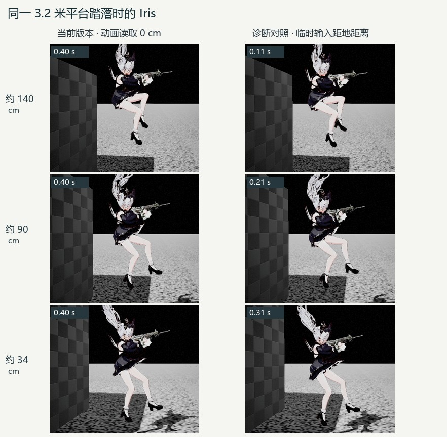

默认输入让这三帧都取到素材的 0.400 s；补入距离后，姿势随接近地面逐步变化。在 140 cm 这一帧，两次运行的 Iris 左脚尖相对胶囊的位置相差约 7.7 cm。图中整个人仍会继续运动，因为最终姿势还包含其他状态和混合。正式实现应从移动组件提供可行走表面的距地信息，并在坡、台阶和移动平台复测。[项目动画实例](../../Source/TPSCPP/Animation/TPSCPPAnimInstance.cpp) · [主动画蓝图](../../Content/Characters/Heroes/Mannequin/Animations/ABP_Mannequin_Base.uasset)

## 肩射为什么停下来后还要收脚

运行中的步枪动画层在肩射右移时选中 `MM_Rifle_Walk_Right_Start`，松键时选中 `MM_Rifle_Jog_Right_Stop`。快速左右换边时，求值器还选中了 `MM_Rifle_Jog_Right_Pivot` 和 `MM_Rifle_Jog_Left_Pivot`。同速 ADS 中观察到了 `MM_Rifle_Walk_Right_Pivot` 和 `MM_Rifle_Walk_Left_Stop`。[共享动画层](../../Content/Characters/Heroes/Mannequin/Animations/LinkedLayers/ABP_ItemAnimLayersBase.uasset) · [步枪动作素材](../../Content/Characters/Heroes/Mannequin/Animations/Locomotion/Rifle/)

在另一轮固定 60 Hz 的平地测试中，两种姿势以 150 cm/s 重放同一组输入。各次松键后约 0.13 s 胶囊停稳。下表记录松键后两只脚尖都收回到最终位置附近的时间，以松键后 1.3 s 的位置为参考，容差 2 cm，按帧取近似值。

| 输入 | 肩射收脚 | ADS 收脚 |
| --- | ---: | ---: |
| 向右持续 3 s 后松键 | 0.53 s | 0.20 s |
| 向左持续 3 s 后松键 | 0.48 s | 0.23 s |
| 向右切向左，再松键 | 0.48 s | 0.22 s |
| 前进 0.60 s 后松键 | 0.45 s | 0.13 s |

收脚时长包括合理的卸重、迈步和回到待机姿势，不能直接当作滑步时长。肩射和 ADS 的最终持枪姿势也有差别。同一肩射状态下单换动作的结果见[四向 Stop 和 Pivot 对照](LandingAndShoulderTests.md#肩射的-stop-和-pivot-怎样对照)。

## 冲刺转向与坡面接触

**冲刺切肩射。** 固定视角，按住向右，先冲刺再进入肩射。角色起始向右运动、面朝 90°；约 0.08 s 后已降到 150 cm/s，此时胶囊仍朝约 50°，到约 0.18 s 才转回 0°。这段速度与朝向的时间差适合检查上身瞄准与下身换脚是否协调。枪口稳定度还需从玩家镜头和对手镜头取样。

**横坡静止。** 让角色保持相同肩射朝向，在平地和倾斜方向相反的两块坡面上站稳。按各脚尖骨的世界坐标计算其正下方坡面高度，取稳定窗口中的垂直间隙中位数。平地左／右为 3.5／3.2 cm，+18° 坡为 2.9／2.3 cm，−18° 坡为 3.1／3.3 cm。虽然这三次的 `UseFootPlacement` 都为 false，最终足部位置仍能随斜面分配高度。脚尖骨与鞋底有固定偏移，横坡跑动及单脚跨阶接触还需另测。

**测试范围。** 2026-11-26，UE 5.8，项目 GameMode、角色与突击步枪，独立 PIE 和临时几何。角色交换视角、收脚与高台对照采用固定 60 Hz；素材取样和截图在单独重放中采集。诊断用的网络开关与动画变量随测试进程退出，项目配置与玩法资产维持检查前的版本。

## 自由朝向跑动时的 180° 回头

在 GameLevel 双人 PIE 的监听主机上，固定 60 FPS，让 Iris 在临时水平地面直跑，同一帧松 W、按 S，将这一帧记为第 0 帧。三组测试均由移动方向控制角色朝向。下表取第 0 帧到随后 39 帧内骨盆最低点的高度差，高度按 Iris 骨盆到地面的垂直距离计算。这些数值对应本次换向时的步相。

| 换向前的步态 | Iris 骨盆高度 | 降幅 | 最低点 | 临时统一用前向 Pivot 后的降幅 |
| --- | --- | ---: | ---: | ---: |
| 空手跑，300 cm/s | 89.9 → 58.4 cm | 31.5 cm | 第 15 帧 | 16.7 cm |
| 空手冲刺，600 cm/s | 94.9 → 64.7 cm | 30.2 cm | 第 14 帧 | 21.7 cm |
| 持步枪冲刺，600 cm/s | 88.9 → 70.1 cm | 18.8 cm | 第 15 帧 | 14.6 cm |

**跟一遍空手跑的换向。** 第 2 帧，动画开始混入后向 Pivot；第 3 帧切到前向 Pivot。到第 8 帧，有效片段已是右向 `MM_Unarmed_Jog_Pivot_Right`。角色沿原路线反向移动，此时身体才转了 58°。第 15 帧，身体转了约 115°，右向片段的采样时间为 0.536 秒，仍贡献约 96% 的姿势。此时 Quinn 骨盆降到 57.3 cm，Iris 降到 58.4 cm。状态机已开始返回跑步循环，第 21 帧 Pivot 权重降到 31%，Iris 骨盆在这 0.10 秒内升回 82.0 cm。身体到第 28 帧才转满 180°。

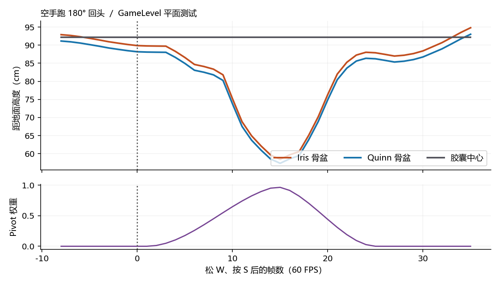

**为何直线折返会采到右转。** 动画层的 `SetUpPivotAnim` 用相对角色朝向的加速度方向选片，`UpdatePivotAnim` 在过渡期间还可按方向换片。虽然玩家一直按 S，身体却在持续旋转，加速度在角色局部空间的方向也随之改变。右向原片本身有明显压身动作，直接取样距根骨的骨盆高度，在 0.50 秒为 62.7 cm，0.60 秒为 58.4 cm。游戏中 Quinn 骨盆从 88.2 cm 降到 57.3 cm，重定向后的 Iris 跟随这段动作。三组的胶囊中心始终在地面上方 92.15 cm，相机高度恒定，移动组件始终贴地。

**隔离选片的对照。** 在独立测试进程中临时把相应动画层的四向 Pivot 都指向同一套步态自己的前向片段。三组的前后速度与角色转角均与原回放逐帧一致。空手跑降幅减少 14.7 cm，最大单帧回升从 6.1 cm 降到 3.2 cm。左右鞋跟、前掌四个蒙皮采样点中的最低点仍低于地面，原版空手跑低约 5.8 cm，临时对照低约 6.1 cm。这个对照确认选片影响压身幅度，但未解决支撑脚接触；测试覆盖一次换向步相，未测另一只脚支撑时的差异。

**后续修改入口。** 先只处理自由朝向的近 180° 折返。用换向前的行进方向与新输入识别折返，按当时的支撑脚选片，在这一步内锁住选择。让回到跑步循环的时机与支撑脚蹬地、骨盆回升对齐。用左右脚分别着地时的 W → S 重测，同时检查骨盆最低点、最大单帧回升、支撑脚水平滑移和穿地深度，再决定是否调整素材。

### 跑动掉头的素材候选

从 Epic 的 Game Animation Sample 衍生项目 GASPALS 的固定版本文件树筛选 `M_Neutral_{Walk,Run,Sprint}_Turn_{L,R}_180_{Lfoot,Rfoot}`，每档 4 条。取 12 条序列和源骨架，在独立 UE 5.8 临时工程按 60 Hz 读取原始姿势。每条的进出水平轨迹相差约 180°，根骨也同向转过约 180°。素材正式获取入口为 [Epic 的 Fab 页面](https://www.fab.com/listings/880e319a-a59e-4ed2-b268-b32dac7fa016)，本次逐条采样的文件来自 [GASPALS 的动画目录](https://github.com/PolygonHive/GASPALS/tree/948a728b3dc5140e37756276f27ced7dbf5a8376/Plugins/GASPALS/Content/Characters/UEFN_Mannequin/Animations)。

| 原片步态及进场速度 | 左转 Lfoot | 左转 Rfoot | 右转 Lfoot | 右转 Rfoot |
| --- | ---: | ---: | ---: | ---: |
| Walk，200 cm/s | 11.0 | 7.8 | 7.3 | 9.9 |
| Run，500 cm/s | 35.0 | 27.1 | 36.9 | 32.1 |
| Sprint，700 cm/s | 30.8 | 28.9 | 26.5 | 32.2 |

数值是源骨架骨盆相对根骨的下沉幅度（cm）。以根骨沿入场方向到达最远处为零时刻，用此前 0.55–0.20 秒的骨盆最高点减去零时刻前后 0.25 秒内的最低点。进场速度取片头 0.20 秒的平均根骨水平速度。这个口径用于素材间比较，和 GameLevel 从按键帧算起的 Iris 降幅不同。

空手 300 cm/s 首测 `M_Neutral_Run_Turn_L_180_Rfoot` 和 `M_Neutral_Run_Turn_R_180_Rfoot`，它们分别是 Run 中左右转下沉最少的一条。两条都属于 Rfoot 步相，后续要与 Lfoot 版本并排检验另一侧来步。`M_Neutral_Walk_Turn_L_180_Rfoot` 可作轻压身对照。冲刺优先检查 `M_Neutral_Sprint_Turn_L_180_Rfoot` 与 `M_Neutral_Sprint_Turn_R_180_Lfoot`。最终采用与否要看重定向到 Iris 后，300/600 cm/s 胶囊轨迹下的支撑脚滑移、鞋底高度和出步连续性。

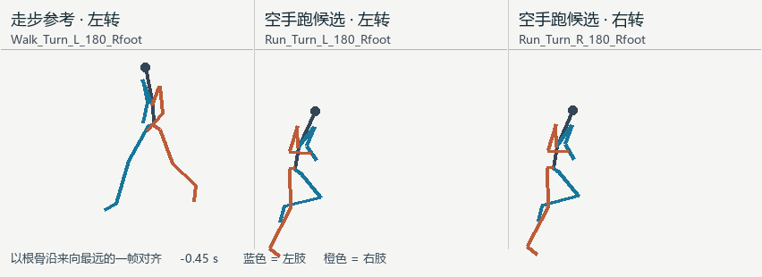

### Iris 实测怎么选跑动掉头

**选片标准。** 制动时允许原片压低重心。优先看脚能否踩住、肩髋能否顺着转身侧旋转，以及蹬出后第一步能否接上跑步循环。骨盆的垂直变化主要用来观察回弹。

在 GameLevel 双人 PIE 的监听主机上用 Iris 空手跑到 300 cm/s，在水平面上松 W 按 S。换向瞬间分别让镜头偏 1°，使角色稳定选择左、右两个转向；两组按键时机相隔 23 帧，实测换向时左右脚踝高差反号。原版、四条 Run、四条 Walk 共采 24 次，固定 60 Hz。每次候选与对应原版在换向帧的鞋底采样点最大差异低于 0.8 cm，之后比较窗口内胶囊位置和朝向逐帧一致。

**临时接线。** 将候选重定向至运行时的 Quinn Simple，再走游戏已有的 Quinn → Iris 链路。测试副本去掉原片水平根位移，按胶囊实测转角补偿根骨旋转；足部 IK 目标补烘到脚踝。用全身槽预览，入段混合 0.10 秒、出段 0.12 秒，令原片根轨迹折返时刻对齐换键后第 7 帧。退出使用候选的转角和出步速度选点。这个试验沿用项目移动响应，尚未接入按脚步相位挑选跑步循环入口的逻辑。

| 换向时较低的脚 | Run 左转优先候选 | Run 右转优先候选 |
| --- | --- | --- |
| 左脚 | `M_Neutral_Run_Turn_L_180_Rfoot` | `M_Neutral_Run_Turn_R_180_Rfoot` |
| 右脚 | `M_Neutral_Run_Turn_L_180_Lfoot` | `M_Neutral_Run_Turn_R_180_Lfoot` |

在换键后第 0–26 帧，用左右鞋跟和前掌四个蒙皮点估计接地滑移：取连续两帧都低于地面上方 3 cm 的点，计算世界水平位移，每帧取其中最小值，再对有效帧取第 90 百分位。该量描述最稳的近地点，不能替代某一只脚整个承重期的总滑移。匹配上表时，Run 四种工况分别为 1.97、3.21、3.50、3.99 cm/帧；对调步相后升至 9.39–12.08 cm/帧。此处的左右脚规则来自这两种来步的实测，素材后缀不能直接当成当前承重脚。

**出步比下沉更值得处理。** 以换向时左脚较低、向左转为例，Run 的近地点滑移在制动段 P90 为 1.97 cm/帧，但回到跑步循环的混合期有一帧达 19.7 cm；同条件 Walk 在混合期最大 7.5 cm。右转且右脚较低时，Run 的混合期峰值达 22.5 cm。Run 各组合在制动窗口还有 8.3–9.4 cm 的鞋底采样点穿地。Walk 原片步速为 200 cm/s，部分组合退出更平顺，可作出步对照。下一次先用 Run 的四种组合保留制动动作，给循环选择与蹬出脚对应的入口，再复测退出滑移和 Iris 鞋底接触。这轮只验证本机可见角色；联机观察端、连续打断和冲刺留待正式状态接入后测。

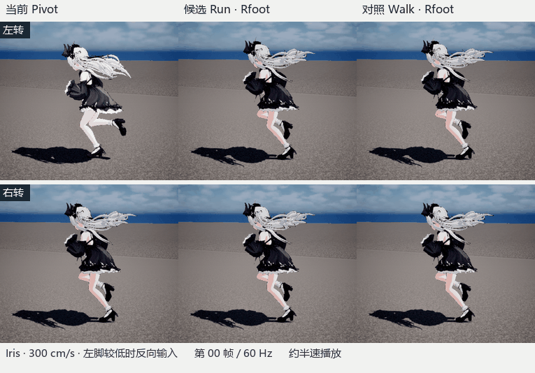

### 正式掉头状态与跑出接步

空手跑的正常入口在主动画蓝图 `ABP_Mannequin_Base → LocomotionSM → Turnaround`。主机和客户端从已有的速度、加速度、接地及朝向模式识别折返。先记住制动前的来向和脚步，再用胶囊实际转过的方向选片；网格网络平滑仅参与旋转补偿。四条片段已经内置在项目中，保留原片髋部高度变化。触发角度和最低来速在主动画蓝图的 **Locomotion | Turnaround** 中调整。四条 Run 和四条 Sprint、各自的退出时间与前跑循环入口在共享物品层的 **Anim Set | Turnaround** 中调整。

| 转向 | 换向时较低的脚 | 片段后缀 | 从片段进入到开始退出 | 前跑循环目标入口 |
| --- | --- | --- | ---: | ---: |
| 左 | 左 | L_180_Rfoot | 1.000 s | 0.217 s |
| 左 | 右 | L_180_Lfoot | 1.033 s | 0.617 s |
| 右 | 左 | R_180_Rfoot | 0.783 s | 0.617 s |
| 右 | 右 | R_180_Lfoot | 0.933 s | 0.417 s |

入口时间依据 Quinn 的骨盆、两侧脚踝和前掌位置及运动方向选定。首次验收时退出混合为 0.12 秒，已接进共享动画层的 `UpdateCycleAnim`；实际前跑序列从匹配的相位继续按移动速度推进。松开反向键、改变意图、离地等中断会结束掉头，不强制跳到正常跑出的相位。

**GameLevel 双端实测。** 监听主机和拥有者客户端轮流输入，分别读取操作者与观察者的状态、有效序列和 Iris 鞋底。固定 60 Hz，空手 300 cm/s，左右各两种来步及精确 180° 全部实测；两端选择的方向与脚步版本一致。操作者在换键后第 2 帧进入，观察者为第 2 或第 3 帧。90° 转向未触发；掉头中松开反向键或起跳都能中断。另在空手冲刺、持枪冲刺、站姿肩射移动及 ADS 移动中做反向输入，状态图在操作者与观察端均未进入 Turnaround。

| 操作者的退出工况 | 上轮全身槽预览 | 正式状态 | 改变 |
| --- | ---: | ---: | ---: |
| 左转，左脚较低，Rfoot | 19.7 cm/帧 | 3.8 cm/帧 | 减少约 81% |
| 右转，右脚较低，Lfoot | 22.5 cm/帧 | 4.8 cm/帧 | 减少约 79% |

沿用前一轮四个鞋底采样点，在退出前一帧至退出后八帧中，取连续两帧都在地面上方 3 cm 以内的点，逐帧取水平位移最小值，再取窗口峰值。这两个例子的本机、客户端操作者都得到表中数值。左转右脚较低的一组在本次采到的退出帧间没有连续近地点，不能据此给它报零滑移。本轮同时改变了退出时刻和前跑循环入口。制动段四条原片的鞋底采样点仍有 8.3–9.4 cm 穿地；后续针对 Iris 的脚底接触处理，保留制动压身。

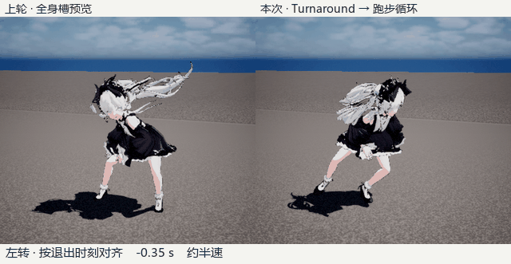

### 固定起点的入口滑移基线

复查同一批 GameLevel 正式状态的 60 Hz 原始记录。以状态首次进入的上一帧为起点，取之后 6 个帧间隔（0.10 秒），跟踪入段前较低一侧的鞋跟与前掌。只统计同一采样点连续两帧都在地面上方 3 cm 以内的水平位移；两点同时符合时取位移较小值。这个指标描述近地滑移，鞋底实际受力未测量。

主机操作者四种来步的单帧峰值按左转左脚低、左转右脚低、右转左脚低、右转右脚低排列，分别为 4.7、6.7、8.2、7.4 cm。右转左脚低时，左前掌在整个窗口内离地约 −0.5 至 1.5 cm，水平净位移 13.3 cm；左转右脚低时，仅前两个间隔满足接地条件。客户端操作者四种工况的峰值分别为 4.7、13.5、13.5、16.0 cm。这版根据哪只脚较低选择片段，每条片段从固定起点进入。

### 掉头入口的步相与支撑脚匹配

**同步组在这里做什么？** 前跑循环的 `Locomotion` 组提供上一个和下一个脚步标记（`L`、`R`），以及两个标记之间已经走过的比例。同样是右脚较低，它可能刚往胶囊前方落，也可能已在身后准备蹬地。只按脚踝高度挑片会把这两种姿势送到同一帧。运行时在收到反向输入时记录一次步相，同时保留两个连续更新的脚踝、前掌位置，用脚跟抬起的程度估计当前接触点及其水平速度。

**如何切入？** 沿用实际转向与来步选定的四条 Run。每条序列自带左右脚标记和 `TurnaroundEntryData`，包含来步一侧的 Quinn 脚踝、前掌采样。先保留步相最接近的一小段，再对候选姿势比较接触点水平位置和速度。正式参数以 0.60 s 为原起点，候选为 0.55–0.667 s，每隔 1/60 s 一项，末尾另有一个采样供计算速度。选定后由 `Sequence Evaluator` 独立推进，入口时间偏差在该片的制动点消退。动画序列的原始制动点因片段而异，为 0.70 或 0.733 s。退出继续用每条 Run 配置的目标前跑相位。

**在哪里调？** 主动画蓝图 Class Defaults → Locomotion → Turnaround → Entry 中，`EntryPhaseTolerance` 是相对最近候选还能放宽多少个半步，默认 0.25。`EntryVelocityWeightSeconds` 把速度差换算为可与位置差比较的距离，默认 0.045 s。例如候选前掌速度相差 100 cm/s，会增加相当于 4.5 cm 位置误差的评分项。候选窗与制动点在各条动画的元数据中。调参时同时看入口、胶囊速度过零以后的支撑段，以及松键和起跳打断。

**入口混合的贡献。** 单独启用选帧、沿用原混合曲线时，客户端四组峰值为 5.4、12.7、13.2、14.9 cm/帧。当轮验收的四条入口过渡采用 0.099 s 线性混合，当时退出为 0.12 s。客户端三组较重滑移的改善来自选帧和混合曲线共同作用。主机右转左脚低仍有约 8.5 cm/帧，单次步相匹配无法约束整段的世界空间脚底轨迹。

**GameLevel 回归。** 监听主机与拥有者客户端轮流操控同一套 Iris，另一端同步观测。临时水平平台、空手前跑 300 cm/s、固定 60 Hz，同样的换键帧和镜头朝向。入口采样沿用上面的定义，单位为 cm/帧，箭头左侧是固定起点，右侧是本次结果。破折号表示该侧鞋底没有连续两帧满足高度门槛。观察端受复制与网格平滑影响，实际切入有时比操作者晚一帧。

| 转向 / 来步较低的脚 | 主机操控 | 客户端看主机 | 客户端操控 | 主机看客户端 |
| --- | ---: | ---: | ---: | ---: |
| 左转 / 左脚 | 4.7 → 5.4 | 4.2 → 4.2 | 4.7 → 5.4 | 4.0 → 4.6 |
| 左转 / 右脚 | 6.7 → 5.7 | — → — | 13.5 → 10.3 | 4.3 → 4.4 |
| 右转 / 左脚 | 8.2 → 8.5 | 8.7 → 3.1 | 13.5 → 10.5 | 5.7 → 6.6 |
| 右转 / 右脚 | 7.4 → 7.3 | 1.7 → 2.6 | 16.0 → 12.0 | 7.2 → 6.9 |

操作者在换键后第 2 帧进入 Turnaround，水平速度在第 7 帧反向。90° 不触发，精确 180° 能进入；第 9 帧松开反向键或起跳，操作者均在第 11 帧离开。两端的操作者分别对齐比较，四组来步在换键帧的胶囊和四个鞋底采样点位置一致。原片骨盆下压保留。

入口后再跟踪 14 个帧间隔，逐帧取四个鞋底采样点中最稳的连续近地点。四组的最大值在主机为 2.1 → 2.1 cm/帧，客户端为 2.1 → 2.6 cm/帧。两端操作者的左转左脚低、右转右脚低两组退出峰值仍为 3.8、4.8 cm/帧。此轮为本机双端 PIE，未模拟公网延迟。

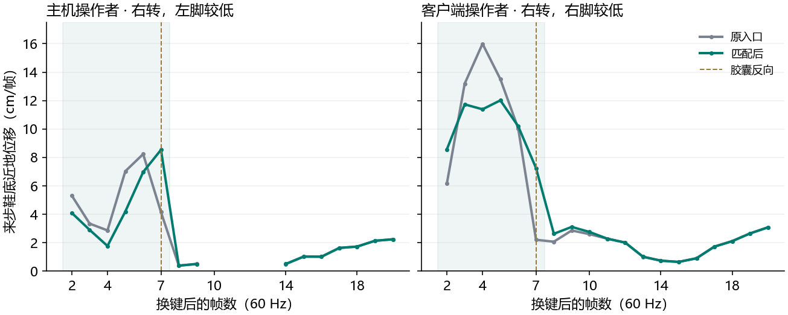

### 左转出口的躯干起身

空手 300 cm/s、GameLevel 水平平台、固定 60 Hz。按下反向键记为第 0 帧。前倾角取 Iris 的 Hips → Neck 连线在角色前向竖直平面内与竖直线的夹角，数值越小表示躯干越直。下表比较退出前最后一帧与六个帧间隔之后的姿势。主机和客户端轮流操控，另端同时采样。表中高度取主机操作者。

| 转向 / 来步较低的脚 | Iris 躯干前倾 | 骨盆升高 | 颈部升高 |
| --- | ---: | ---: | ---: |
| 左转 / 左脚，L_180_Rfoot | 43.0° → 30.1° | 5.7 cm | 11.9 cm |
| 左转 / 右脚，L_180_Lfoot | 31.3° → 29.2° | 4.7 cm | 5.3 cm |
| 右转 / 左脚，R_180_Rfoot | 36.1° → 30.0° | 3.9 cm | 6.4 cm |
| 右转 / 右脚，R_180_Lfoot | 35.8° → 32.2° | 3.8 cm | 4.6 cm |

**最明显的是左转左脚低。** 第 51–57 帧，胶囊高度稳定，肩背随收髋一起抬起。Quinn 源网格的 pelvis → neck_01 也从 40.2° 收至 30.6°。两端操作者均复现表中 12.9° 的起身，观察端也能看到。第 53 帧约收直 3.5°，变化集中在混合前半段，跑步循环权重在第 57 帧达到 50%。

**对照。** 仅在临时 PIE 进程内将片段退出推迟 0.30 s，同一输入和同一时间窗内掉头权重保持 100%。此时躯干仍从 43.0° 收至 34.6°，颈部升高 7.4 cm。说明原片已经在起身；叠加前跑混合后，这六帧又多收直约 4.5°，颈部再多升约 4.5 cm。第 63 帧，正常切回循环时躯干为 23.4°，对照仍为 36.3°。推迟退出只用于定位原因。

**实际出口时钟。** 本次这条左转的掉头权重从第 52 帧的 91.7% 线性减至第 63 帧的 0%，实际约 0.20 s。`UpdateTurnaround` 的交接计时仍按 0.12 s 结束。第 60–62 帧，掉头序列时间停在 1.567 s，剩余权重从 25% 降至 8.3%；前跑序列继续播放。这个尾部停帧发生在最明显的起身之后。后续修复与双端复测见下节。

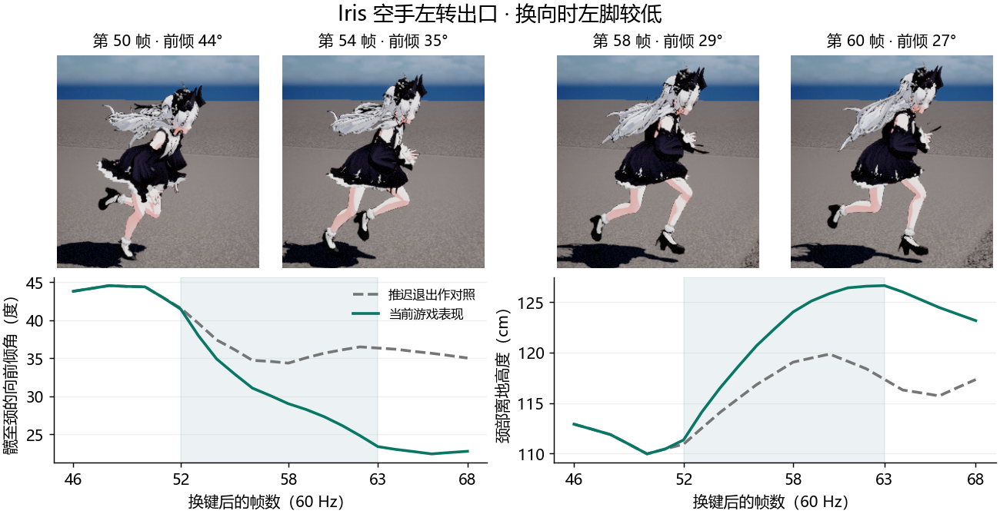

### 回转跑出时的摆腿节奏

GameLevel 双人监听主机、固定 60 Hz，主机操控，客户端同时采样。同一路段测空手普通跑、空手冲刺、持步枪冲刺各四次，覆盖两侧转向和两种片段。下表取主机左转的代表样本。两端各自使用已有的支撑脚选择。按实际 Iris 左右踝交替抬到最高点之间的时间计半步；回转取开始退出当帧及之前最后一个完整半步，Cycle 取退出混合完成后稳定直跑的多个半步中位数。腿摆量为半步内髋到脚踝连线在角色前向竖直平面上的累计角行程，取双腿平均。表中两段测量时胶囊都已达到对应步态的满速。

| 左转样本 | 半步帧数，回转 → Cycle | 每半步腿摆量 | 平均腿摆角速度 |
| --- | ---: | ---: | ---: |
| 空手跑，300 cm/s | 12 → 20 | 42° → 57° | 209 → 170°/s |
| 空手冲刺，600 cm/s | 10 → 17 | 31° → 79° | 187 → 276°/s |
| 步枪冲刺，600 cm/s | 8 → 17 | 24° → 77° | 177 → 278°/s |

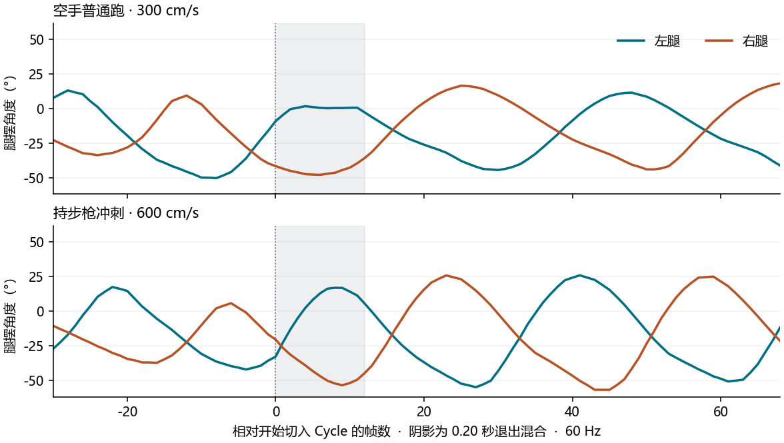

回转在制动点之后以 1 倍速推进，Stride Warping 改变脚步跨度。前跑 Cycle 在共享层的 `UpdateCycleAnim` 按速度调用 `SetPlayrateToMatchSpeed`，正常退出时还会校准到片段配置的 Cycle 相位。普通跑的代表样本中，退出混合第 5 至 11 帧左腿角度维持在约 0–1°；冲刺回转末段则以短步、更小的摆幅过渡到大步前跑。

### 跑出接点、播放速度与步幅的联合调校

每个来步片段在对应物品层的 **Anim Set → Turnaround → Run Out** 配置跑出调速上限和额外步幅额度。空手与步枪用各自的前跑循环相位。脚踝摆动方向、跨入循环的半步时长、近地滑移和六帧躯干倾角变化共同决定取舍。12 个步态、转向和来步组合中调整了 6 个，其中 4 个启用跑出调速，另 2 个只更新循环接点。

制动点以前按原有入口时钟播放。制动后，片段参考轨迹和胶囊速度都转向新方向时，根据两者的速度比限幅推进 A/B 各自的片段时钟。退出使用这个时钟上的配置时刻。步幅倍率用实际速度除以「片段参考速度 × 当前播放倍率」，只补剩余的速度差。默认的两个新增值均为零。入选样本的播放倍率最多修正 8%–12%，既有 ±15% 步幅上限仅在适用的跑出段额外放宽 4–8 个百分点。额外额度和调速权重都随方向与速度渐入。

| 主机操作者样本 | 横跨退出或紧随其后的半步，改前 → 改后（帧） | 近地鞋底峰值，改前 → 改后（cm/帧） |
| --- | --- | ---: |
| 空手普通跑，左转 Lfoot 片段 | 17、22 → 14、20 | 5.42 → 4.92 |
| 空手冲刺，左转 Lfoot 片段 | 10、11、16 → 15、16 | 4.47 → 5.23 |
| 步枪冲刺，左转 Rfoot 片段 | 14、18 → 17、18 | 10.77 → 6.09 |
| 步枪冲刺，左转 Lfoot 片段 | 13、18 → 15、18 | 4.65 → 4.86 |
| 步枪冲刺，右转 Lfoot 片段 | 15、16 → 17、16 | 13.16 → 8.75 |

空手普通跑代表样本的左腿在退出混合中连续每帧摆角变化小于 1° 的最长时段由 7 帧缩至 1 帧，第一步仍较稳定 Cycle 的 20 帧短。表中半步按左右脚踝交替抬到最高的时刻计数；滑移沿用连续两帧距测试地面 3 cm 内的同一鞋底采样点，每帧间隔取可用点中的最小水平位移，再取退出混合窗口峰值。个别冲刺来步用少量滑移换取更均匀的换脚间隔。试验中过早切循环曾出现 37 帧长步。

最终从已保存的资产重新启动 GameLevel 双人监听主机和客户端，各自操控 12 组首回转，主机操作者逐帧胶囊速率与基线一致。附加的持枪连续折返在两个操作端均于换键后第 2、24、44 帧进入 A、B、A，观察端对应第 3、25、45 帧，随后起跳能中断回转。动图按同一换向输入对齐，每两帧取样并约半速播放。

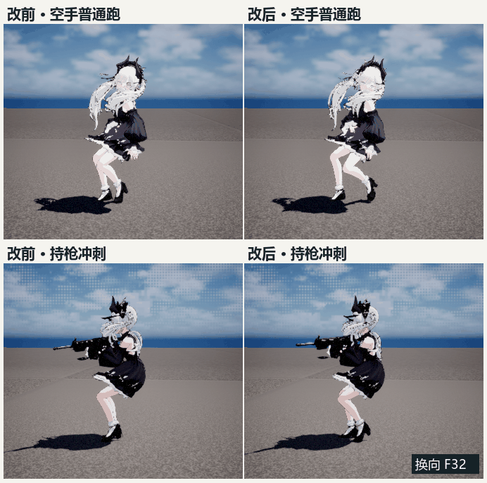

### 空手冲刺左转的出口步幅

空手冲刺左转选中 `AS_SprintTurn_L_180_Lfoot` 时，交接半步保持 **15、16 帧**，操作者首轮近地鞋底峰值由 **5.23 降到 4.39 cm/帧**。历史调步频前同一来步为 4.47 cm/帧。峰值仍出现在右脚支撑、开始退出的第一帧。

**如何调整。** 打开 `ABP_UnarmedAnimLayers`，在 Class Defaults → Anim Set → Turnaround → Sprint → Sprint Left Turn → Left Foot Low → Run Out 设置 **Exit Stride Scale = 1.33**、**Exit Stride Lead Time = 0.016667 s**。提前量按片段时钟计算。目标从退出前最后一个采样点持续到跨过出口的采样点，之后交回原有步幅，节点自身的插值与状态混合负责淡出。1.33 是输入目标，节点会渐进接近它。该来步的播放倍率修正上限仍是 12%，退出时刻 0.966667 s，前跑 Cycle 接点 1.672333 s。

**为什么调额外额度几乎没用。** 原共享层两条回转支路都把 Stride Scale Modifier 的 Clamp Max 设为 1.0。退出前一帧虽然收到 1.160 的输入，实际仍按 1.0 限幅。试验中只变更额外额度时，配对回放四个鞋底点的轨迹逐帧相同。现在 A/B 两个节点允许接收片段的伸展目标，原先在插值前执行的 1.0 上限移到层输入。默认 Exit Stride Scale 为 1.0，此次只有空手冲刺左转的这一种来步启用伸展。试验中从制动后一路伸展会把首个半步推到 16 帧，因此将修正集中在交接的支撑步。

**GameLevel 双人监听服，固定 60 Hz。** 主机、客户端各操控三次同一来步，双方同步采样。下表为各自第一轮的退出窗口鞋底峰值，单位 cm/帧。

| 操控端 | 操作者，调整前 → 保存后 | 对端观察，调整前 → 保存后 |
| --- | ---: | ---: |
| 主机 | 5.23 → 4.39 | 5.27 → 4.42 |
| 客户端 | 5.23 → 4.39 | 5.22 → 4.37 |

六次折返的两端均保有 15、16 帧半步和三个有效近地间隔，峰值范围为 4.33–4.42 cm/帧。两种操作端首轮的胶囊速率与片段取样时间分别与各自基线逐帧相同。额外检查了退出前八帧和窗口之后的十二帧，两段近地峰值分别维持 1.96、0.87 cm/帧。

### 左转接步修复与复测

`L_180_Rfoot` 退出时刻调整为换向后 1.000 s，目标前跑循环起点为 0.217 s。轮换来步时其他三条继续使用各自配置。选择时先在片段和跑步循环中比较脚踝、前掌、骨盆与颈部的轨迹，再在 GameLevel 平台实测候选组合。选中的接点让原片先完成制动后的第一次抬身，再在下一步中融入前跑；这组片段配置现位于共享物品层。交接期间 C++ 每次更新读取 LocomotionSM 中 Turnaround 的实际权重，原片仍有贡献时继续播放；蓝图控制退出过渡的时长和曲线。

以下为主机操作者，固定 60 Hz。前倾角和颈部高度用 Iris 实际骨骼计算。完整出口指退出前一帧至循环权重达 100% 的 12 个帧间隔；滑移取同一鞋底点连续两帧距地面上方不超过 3 cm 时的水平位移，每个间隔取可用点中的最小值。

| 左转左脚低的出口 | 改前 | 改后 |
| --- | ---: | ---: |
| 开始退出的帧（换键为第 0 帧） | 52 | 62 |
| 退出开始后 0.10 s 的躯干收直量 | 12.9° | 5.0° |
| 整个出口任意连续 0.10 s 内，最大的颈部高度变化 | 12.7 cm | 7.7 cm |
| 完整出口的近地鞋底单帧峰值 | 4.85 cm | 2.77 cm |
| 有连续近地鞋底点的间隔 | 6/12 | 9/12 |

把窗口扩到从换键后第 40 帧至换键后第 76 帧，主机操作者任意连续六帧的最大收直量由 13.3° 降至 9.7°，最大颈部抬升由 12.7 降至 8.7 cm。两端操作者得到相同的出口结果；客户端观察主机时，开始混合后 0.10 s 内收直 5.0°，主机观察客户端时为 5.6°。若沿用早期只取前九个间隔的鞋底口径，本次为 2.49 → 2.77 cm/帧。其余三种来步的完整出口滑移峰值与改前相同。90° 未进入掉头，精确 180° 正常进入，退出中断另按掉头中途松键和起跳验证，两端操作者均在换键后第 11 帧离开。

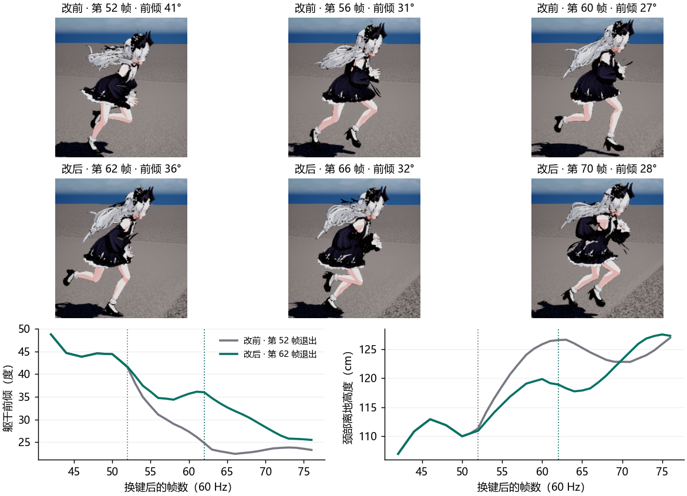

### Turnaround 的三层接线与连续折返

**在编辑器里沿这条路径查看。**

| 打开资产 | 进入位置 | 负责什么 |
| --- | --- | --- |
| `ABP_Mannequin_Base` | `LocomotionSM → Turnaround` | 从角色移动组件识别折返、记录来向与支撑脚，调用 `ALI_ItemAnimLayers.FullBody_TurnaroundState`。首次进入默认要求来速至少 150 cm/s、转角至少 150°。 |
| `ABP_ItemAnimLayersBase` | `FullBody_TurnaroundState → TurnaroundSM → TurnaroundA / TurnaroundB` | 两支都依次经过 Sequence Evaluator、Rotate Root Bone、组件空间的 Orientation Warping 与 Stride Warping。共享层的 C++ 父类 `UTurnaroundAnimLayer` 给每支提供独立片段、取样时间、旋转补偿和扭曲输入。 |
| `ABP_ItemAnimLayersBase` 的默认值与武器子层 | Class Defaults → **Anim Set → Turnaround** | 共享层持有 Run / Sprint 两组片段、各自的退出时刻和循环入口。步枪和手枪子层提供自己的冲刺持姿片段与采样时刻。 |

**A/B 表示播放位置，左右转由片段决定。** 第一次进入 A。回转中再按反方向，共享层选下一条片段的支撑脚与入口帧，在 B 中从该帧起播；再次反向则回 A。两支分别保留自己的入口朝向，按 0.10 秒三次曲线交接，淡出的原片继续推进。连续三个输入挤在同一次交接内时，保留仍有效的反向请求，待目标分支的实际权重归零才换片。持续按住同一方向只触发一次。正常跑出仍由共享层的 `UpdateCycleAnim` 接到各片对应的前跑步相。

**扭曲参数怎么调。** 共享物品层的 **Anim Set → Turnaround → Warping** 可调最大朝向修正（默认 20°）、最大步幅修正（默认 0.15，即倍率 0.85–1.15）和低速衰减阈值（默认 80 cm/s）。两支复用 Pivot 的脊柱、骨盆和 IK 脚链设置。四条 Run 已去除水平根位移，朝向和步幅节点使用 Manual 输入。每条片段的 `TurnaroundEntryData.TravelVelocity` 保留源片按 60 Hz 采样的水平速度曲线，以进场方向为 +X，并将头 0.20 秒的典型来速校准为游戏中的 300 cm/s。节点按当前取样时刻比较胶囊速度和参考速度。两者接近零或暂时朝向相反时，逐渐减弱修正，保留制动脚和片段自带的髋部下压。替换掉头动画时应一起更新入口脚采样、制动时间和参考速度曲线。

**GameLevel 复测。** 固定 60 Hz，监听主机与客户端轮流操控，在同一水平平台记录 Iris 鞋底和骨骼。下表为主机操作者，改前取上一次左转出口修复后的同输入回放。鞋底峰值沿用上节完整出口的近地口径。

| 转身侧 / 较低脚 | 开始退出帧，改前 → 改后 | 出口开始后 0.10 s 收直量，改前 → 改后¹ | 出口近地鞋底峰值，改前 → 改后 |
| --- | --- | --- | --- |
| 左 / 左 | 62 → 62 | 5.00° → 4.99° | 2.77 → 2.70 cm/帧 |
| 左 / 右 | 64 → 64 | 2.16° → 2.18° | 5.43 → 5.44 cm/帧 |
| 右 / 左 | 49 → 49 | 6.09° → 6.09° | 5.48 → 5.50 cm/帧 |
| 右 / 右 | 58 → 58 | 3.62° → 3.61° | 4.32 → 4.39 cm/帧 |

¹ 从切出前最后一帧起取六个帧间隔。四组出口鞋底峰值的变化在 0.07 cm/帧以内，结果未显示普遍减少滑脚。

连续三次反向的一组输入中，主机操作者在第 2、29、54 帧分别选中 A、B、A。第 31 帧两支各占 50%，第 34 帧 B 达到 100%。将后两次输入压到相隔三帧，实测在第 22、28 帧先后切支，原先正在淡出的片段完整走到零权重。另用 162° 转向分别测试 220 和 370 cm/s，第 44 帧步幅节点权重均为 1，实际输入倍率分别为 0.85 和 1.15。两次在制动过零附近的扭曲权重都降到零。

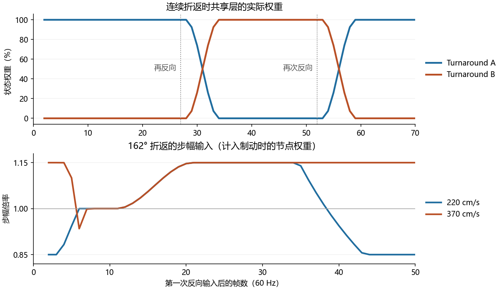

同一组 162° 输入另作一次对照，在第 14–50 帧临时关闭引擎的 Orientation Warping 和 Stride Warping。两次回放逐帧核对了胶囊位置、片段和采样时间。开启两个节点后，第 44 帧 Iris 四个鞋底点的水平位置相对关闭时相差 4.10–24.92 cm（220 cm/s）和 2.82–25.53 cm（370 cm/s）。这个距离衡量两种姿势的落脚位置差。滑移则用同一次回放相邻帧的近地鞋底点计算。第 16–50 帧各有 32 个有效间隔，结果如下。

| 设定跑速 | 近地滑移中位数，关闭 → 开启 | 近地滑移单帧峰值，关闭 → 开启 |
| --- | --- | --- |
| 220 cm/s | 1.83 → 1.40 cm/帧 | 4.79 → 3.80 cm/帧 |
| 370 cm/s | 2.00 → 1.46 cm/帧 | 5.16 → 5.47 cm/帧 |

客户端操作者也在第 2、29、54 帧完成同组 A→B→A，监听主机观察该客户端时对应第 3、30、55 帧。90° 转向未进入回转，180° 折返正常进入，第 9 帧松键或起跳时，两端操作者均在第 11 帧结束回转。

回转中捡起步枪会立刻重连物品动画层。只要主图里的旧回转仍有权重，新层就用换层前的网格姿势快照完成剩余淡出。主机与客户端分别操作时，操作者和对端都切到步枪层；换层当帧 Iris 骨盆高度变化为 0.18–0.30 cm，颈部高度变化为 0.01–0.10 cm。之后分别实测步枪肩射、ADS 及冲刺折返，均未进入空手回转。

**改造前为什么按住冲刺回头还能看到 Pivot？** 在已有的 GameLevel 60 Hz 回放里，空手和持步枪以 600 cm/s 冲刺时，操作者都在 W 换 S 后第 2 帧进入主图的 `Pivot`。步枪层随后先后取样 `MM_Rifle_Jog_Fwd_Pivot` 和 `MM_Rifle_Jog_Left_Pivot`。`UTPSCPPAnimInstance::UpdateTurnaround` 的入口显式排除了冲刺和持枪，冲刺即使采用移动朝向也会走原有 Pivot。上面的 370 cm/s 扭曲验证只调整了空手跑的速度上限，没有激活冲刺状态。

### 持枪冲刺回转的架构核查

以下是改造前的接线和双端基线。当前实现与复测见[按朝向分流的冲刺回转](SprintTurnaround.md)。

**现有持枪姿势来自哪一层？** 步枪冲刺折返目前直接播放带持枪动作的步枪全身序列。GameLevel 监听主机持枪、600 cm/s 换向的回放中，换键帧能读到 `MM_Rifle_Jog_Fwd`，第 12 帧能读到 `MM_Rifle_Jog_Left_Pivot`。在第 0–15 帧，操作者和观察客户端的 `HipFireUpperBodyOverrideWeight`、`AimOffsetBlendWeight`、`LeftHandPoseOverrideWeight` 均为 0。改用中性 Sprint Turn 后，需要另行提供随身体转动的持枪冲刺姿势。

| 沿姿势输出追踪 | 已接线的职责 | 对持枪回转的影响 |
| --- | --- | --- |
| 主图 `LocomotionSM` | Turnaround 入口读 `bTurnaroundActive`。原有 `PivotSources → Pivot` 检查速度与加速度点积以及是否撞墙，未检查朝向方式。 | 两条路应消费同一个折返分类。保留首次进入的来速和转角门槛，防止等判定转身侧的一两帧抢先进入 Pivot。 |
| 共享层 `FullBody_TurnaroundState` | `TurnaroundSM` 求值 A/B；换物品层时可选上一帧快照。默认片段由当前物品子层提供；步枪和手枪子层的四个回转槽均为空。 | 为各物品层提供可共享的按步态回转片段和接步参数。只放宽 C++ 入口，`StartTurn` 仍会因片段为空返回。 |
| 共享层 `FullBody_PivotState` | `PivotSM` 输出作为基姿势，通过 `UpperBodyMask` 按骨混入物品姿势，权重取 `HipFireUpperBodyOverrideWeight`。 | 建议在正常的 Turnaround A/B 输出后，复用该蒙版混入武器层提供的冲刺持姿。权重应由持枪冲刺驱动；换层快照已经包含上一帧的持枪姿势，继续单独输出。 |
| 主图 `UpperbodyLowerbodySplit` | 两路都来自缓存 `Locomotion`。覆盖路经过 `UpperBody` 蒙太奇插槽，使用 `UpperBodyLowerBodySplitMask`，再送往 `FullBody_Aiming`。 | 现有插槽负责蒙太奇叠加。持续握枪姿势可以在前面的物品层生成，同时保留这里的开火、换弹等叠加入口。 |
| `ABP_Iris` | Iris 先从源网格重定向，再把 `LeftHandSocketTarget` 送入 Control Rig；持枪且未换弹时启用握持输入。共享层另有手部 IK 与使用 `LeftFingersMask` 的左手姿势覆盖。 | 武器层先给出肩、肘、腕的持枪关系，Iris 的末端校正继续使用武器握点。 |

两张上身蒙版已有区别。Pivot 的 `UpperBodyMask` 在骨盆和大腿上为 0，沿五节脊柱由 0.1 增至 0.5，左锁骨 0.65、上臂 0.75、手 1.0。主图插槽蒙版的骨盆为 0.1、上臂为 1.0。保留回转的压身和蹬地时，优先试前者。

**朝向模式在对端是否一致？** 固定 60 Hz，监听主机和客户端轮流持步枪冲刺。下表取换键后第 0–15 帧，16 帧的读数均一致。`GameplayTag_IsDashing` 是主动画蓝图对 `State.Sprint` 的映射。

| 操作与观察组合 | 操作者的 `bOrientRotationToMovement` | 观察者的 `bOrientRotationToMovement` | 两端的冲刺标签 |
| --- | --- | --- | --- |
| 主机操作，客户端观察 | 真 | **假** | 真 |
| 客户端操作，主机观察 | 真 | 真 | 真 |

这次基线检查确定了三个改动位置：角色复制朝向模式，移动状态机按该模式分流，物品层混入武器持姿。[实现与主机、客户端对照](SprintTurnaround.md)
