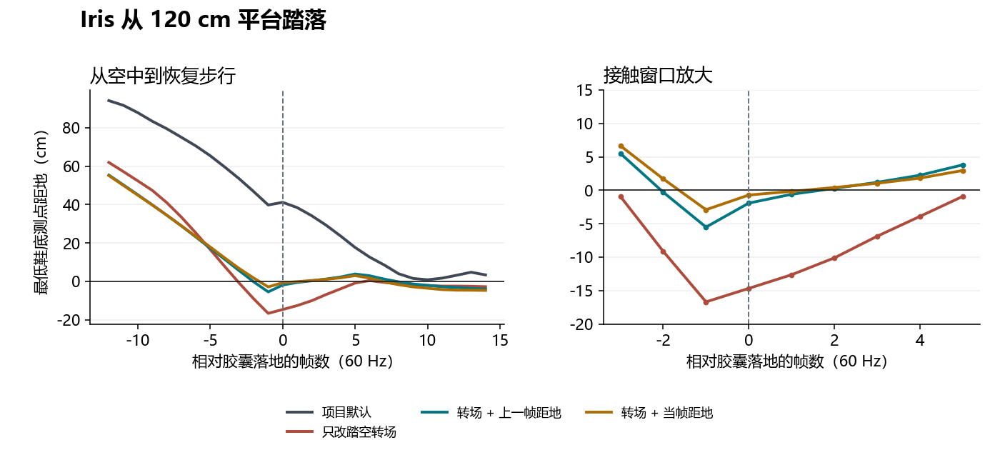

# 为什么 Iris 从 120 cm 平台落地时还悬着

[基础移动品质](LocomotionQuality.md) / [落地预备与肩射换脚](LandingAndShoulderTests.md)

Iris 持步枪以 150 cm/s 肩射走下 120 cm 平台，胶囊在空中经过 28 帧。**胶囊着地那一帧，右前掌仍高出地面 41.15 cm，另外三个鞋底测点更高。** 第 +10 帧（约 167 ms）才首次进入离地 1 cm 内，下一帧又升到 1.7 cm。在玩家视角里，角色已经可以沿地面继续走，双腿却还收在空中。

## 哪一步错过了落地预备

从上沿踏空时，主动画蓝图的地面状态通过 `IsFalling` 进入 `JumpApex`（腾空顶点姿势）。从那里到 `FallLoop` 的转场使用动画播放器的自动过渡，混合时长 0.133 秒。只有从 `FallLoop` 才能按距地条件进入 `FallLand`（落地预备）。这一次胶囊先着地，状态从 `JumpApex` 直接回到步行 `Cycle`。在同样输入下，从 320 cm 踏落有 47 帧滞空，能走完这条动画路径。

只在运行时填入真实距地值，120 cm 的姿势、触地帧和 41.15 cm 悬空量都与默认一致。落地素材求值器即使显示 0.400 秒，也要先看状态是否真正进入，再解读这个数。[主动画状态机](../../Content/Characters/Heroes/Mannequin/Animations/ABP_Mannequin_Base.uasset) · [落地素材的距离匹配](../../Content/Characters/Heroes/Mannequin/Animations/LinkedLayers/ABP_ItemAnimLayersBase.uasset)

## 在同一台沿拆开两项改动

在临时 PIE 实例中，将从地面踏空的出口改接 `FallLoop`，保留主动起跳原有的状态路径。独立控制另一项变量，把脚下碰撞面到胶囊底的垂直距离提供给原有的落地素材。表中第 0 帧为胶囊落地，正数表示鞋底高于地面，负数表示测点穿入。

| 120 cm 平台，60 Hz | 首次进入落地预备 | 第 −1 帧最低鞋底 | 第 0 帧最低鞋底 |
| --- | ---: | ---: | ---: |
| 当前项目 | 未进入 | +39.75 cm | **+41.15 cm** |
| 只提供实际距地 | 未进入 | +39.75 cm | +41.15 cm |
| 只改踏空转场 | −27 帧 | −16.69 cm | −14.67 cm |
| 改转场，并在移动后采样、供下次动画更新使用 | −27 帧 | **−5.51 cm** | **−1.92 cm** |
| 改转场，在移动组件更新位置后立即供当帧动画使用 | −27 帧 | **−2.91 cm** | **−0.71 cm** |

转场解决了空中收腿持续过久的问题。进入正确状态后，控制脚伸出多少的是落地素材的取样时间。使用上一帧距地时，在第 −1 帧右脚鞋跟还在地面上方 2.14 cm，前掌已低于地面 5.51 cm。在移动组件更新位置后立即供值，落地前一帧求值器取到素材的 0.399 秒，穿入缩小到 2.91 cm。再按垂直速度多预测一帧，120 cm 平台触地时穿入 0.82 cm，78.44 cm 平台则从 0.76 扩大到 2.02 cm。

给距离输入固定增加 10、25 cm 后，第 −1 帧的穿入分别扩大到 8.22、9.86 cm。素材采到了更早的姿势，这段素材里更早的姿势反而把前掌压得更低。因而这两个偏移量只保留为诊断对照。

## 是否适合设为默认

以下取胶囊触地当帧的最低鞋底间隙。每条路线的各次走测中，胶囊和最终相机轨迹逐帧相同。

| 场景 | 项目默认 | 改转场并提供当帧距地 |
| --- | ---: | ---: |
| 原地跳回平地 | +0.76 cm | +0.73 cm |
| 走下 120 cm 到平地 | +41.15 cm | −0.71 cm |
| 走下 320 cm 到平地 | +0.36 cm | −0.75 cm |
| 走下等高 78.44 cm 测试平台 | +36.97 cm | −0.76 cm |
| 从高台踏落至 15° 上坡面 | −0.26 cm | −2.45 cm |

**实际对战地图决定了这版能否采用。** 在 GameLevel 的 55 cm 标记台走东沿两次、西沿一次，当帧距地候选与当前版本的鞋底、骨盆和实际枪口在主机及客户端操作者上均一致。电车站 78.44 cm 侧沿依然在第 120 帧离地、第 141 帧着地，胶囊与相机的轨迹一致。落地时鞋底间隙从 +36.74 变为 −0.89 cm，但第 132 帧的实际 `MuzzleFlash` 枪口位置相对默认偏移 **33.18 cm（主机）/ 33.19 cm（客户端）**。数值是两个姿势在同一帧的三维距离。射击结果尚未实测。跨沿后的平地试次，鞋底和枪口还有最多 0.13 cm 的配对轨迹差。[GameLevel 主机与客户端逐帧对照](ShortFallGameLevel.csv)

因此生产资产保留现配置。下一版应把落地预备限定在下半身，先逐帧保证上身持枪和实际枪口与已有轨迹一致，再处理接触前右前掌仍穿入的 2.91 cm。55 cm 东西沿与电车站同时作为回归点。[当前默认的台沿与电车站验收](IrisLedgeWeightTransfer.md)

## 怎样复查

### 只调整双腿的对照条件

这项试验已完成。只伸腿仍悬空 14.54 cm；加入髋部缓冲、双腕补偿和支撑脚固定后，120 cm 的标准样本落地当帧贴地，实际枪口保持原轨迹。[同机位慢放、可切换实现与实景回归](IrisShortFallGrip.md)

保留当前肩射姿势、骨盆、持枪手与枪口。对踏空后能在半秒内接到下层的短落差，试验让靠近地面的腿在下降过程中逐渐伸向支撑面。腿长取原骨架，鞋底接触取前掌与后跟中较低的一点。记录原姿势在不动髋关节时能触及的最低高度，与实际腿部求解后的高度对照。用主动起跳、高台、平地和原有 55 cm 贴地路线复查触发范围；78.44 cm 电车站另查操作者相机和实际枪口的三维轨迹。

在 60 Hz 双人监听 PIE 用主机操控 Iris，按住步枪肩射，在 3 m 宽的 120 cm 平台中心站定，向前输入直至落到下层平地。用移动组件首次从 Falling 变回 Walking 的帧作第 0 帧。四个鞋底点取 Iris 网格左右后跟和前掌，每点在自己的 XY 位置查询实际地面。本文的接触间隙为四点的最小值，精确到 0.01 cm。两脚吃力的大小还需结合骨盆和膝盖的连续动作判断。

CSV 可筛选 `route=flat120`、`frame_from_land=-1` 或 `0`。基础四组为 `current`、`distance`、`direct` 和 `distance_direct`。当帧距地用 `samedirect`，多预测一帧用 `samereach`。`fall_land_asset_s` 为序列求值器读数，`state` 为当帧主状态。其它列保留胶囊、骨盆、最终相机、四个鞋底和距地输入。[五条路线、八种配置的逐帧数据](ShortFallContact.csv)
