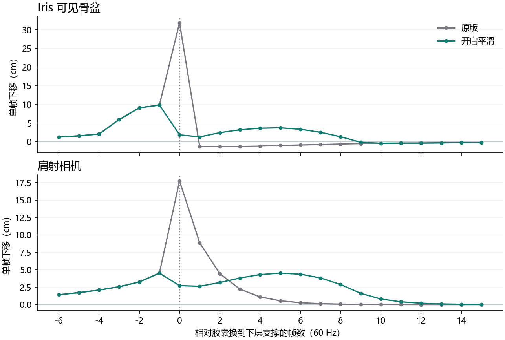

# Iris 肩射走下台沿

[角色与战斗进度](../CombatProgress.md) / [台沿下坠的成因](GameLevelLedge.md)

本页保留第一次平滑的前后对照。当前默认版本在此基础上增加了鞋底支撑与提前屈膝，标准东沿的骨盆单帧下移峰值已降至 5.93 cm。[当前版本的慢放与测量](IrisLedgeWeightTransfer.md)

走下 GameLevel 的 55 cm 武器标记台时，胶囊仍在一帧内完成最后 **30.96 cm** 的贴地校正。现在，监听主机看到的 Iris 骨盆全程最大单帧下移从 **31.88 降至 9.82–9.83 cm**，肩射镜头从 **17.74 降至 4.51 cm**。让远程客户端亲自操控 Iris，也测到了相同量级的改善。电车站 78.44 cm 侧沿仍触发完整的正常下落。

## 画面上改变了哪一帧

把胶囊开始由下层地面支撑的时刻记为第 0 帧。下表取监听主机第一次向东走下，数值均为该帧的**下移量**，单位 cm；最后一行取整段跨沿的最大值。

| 取样位置 | 胶囊，关 / 开 | 可见骨盆，关 / 开 | 肩射镜头，关 / 开 |
| --- | ---: | ---: | ---: |
| −1 帧，胶囊仍搭在上沿 | 5.78 / 5.78 | 9.82 / 9.82 | 4.51 / 4.51 |
| **第 0 帧，切到下层** | **30.96 / 30.96** | **31.88 / 1.86** | **17.74 / 2.73** |
| 全程单帧峰值 | 30.96 / 30.96 | 31.88 / 9.82 | 17.74 / 4.51 |

切到下层时，画出的 Iris 和步枪比各自组件高约 30.02 cm，接下来逐渐跟到胶囊。第 +9 帧身体补偿归零；第 +10 帧，镜头距原轨迹已小于 1 cm。跨沿前一帧仍能看到约 9.82 cm 的骨盆下降。此时左脚尖骨的投影仍在标记台上，骨点已经低于顶面约 19.4 cm，右脚尖骨离下层还有约 24.1 cm。这给下一轮支撑脚卸重和迈步接地提供了具体的检查帧。脚尖骨的高度不能直接当作鞋底穿透深度。

## 角色和镜头如何跟到新高度

1. **先由移动组件决定站在哪里。** 每次角色移动更新后，检查前后两次均为肩射 Walking、支撑面可行走且位置连续。角色正在水平移动、胶囊和支撑接触点都突然下降至少 12 cm、胶囊降幅又在最大台阶高度内时，才开始补偿。本关角色的最大台阶高度为 45 cm。
2. **把余下高度分摊到约 0.16 秒。** 以胶囊本次下降量为起点，按平滑曲线收回垂直偏移。Iris 和挂在其下的步枪使用同一绘制偏移。角色碰撞、原始骨骼和武器挂点继续跟随移动组件。补偿期间，画出的模型与碰撞位置有短暂高度差，本例最大约 30 cm。
3. **操作者的镜头同步跟随。** 在原弹簧臂目标的世界 Z 偏移上加减本次补偿，继续使用已有镜头滞后。退出肩射或进入 Falling 时清除补偿。组件参数为 `MinimumDrop` 和 `RecoveryTime`。[表现组件](../../Source/TPSCPP/Components/LedgePresentationComponent.cpp) · [默认参数](../../Source/TPSCPP/Components/LedgePresentationComponent.h)

## 用同一条路线复测

在 UE 5.8 的 GameLevel 启动双人监听服 PIE，开启渲染，模拟固定为 60 Hz。装备突击步枪、按住肩射，以 150 cm/s 直行。每种操作角色分别在新进程运行 `tps.ShoulderStepDown 0` 和 `tps.ShoulderStepDown 1`；项目默认值为 1。

| 路线 | 重放方法 | 通过条件与本次结果 |
| --- | --- | --- |
| 55 cm 标记台 | `WB_WeaponMarker_06` 顶面 Z = 55，下层 Z ≈ 0。由 (−112, −1650) 向 +X 走出东沿两次，再由 (−88, −1650) 向 −X 走出西沿一次。 | 主机、客户端各三次均保持 Walking。客户端骨盆单帧峰值约 31.89 → 9.82–9.83 cm，相机 17.74 → 4.51 cm。每个试次内，开关两组的胶囊位置和实际枪口挂点轨迹逐帧一致。 |
| 78.44 cm 电车站侧沿 | 从 `WB_TramStation_Stair_Step_02` 的 (1663.61, −1011.69) 向 +Y 走下侧面，顶面 Z = 93.44，下层 `WB_TramStation_Floor` 的 Z = 15。 | 两种操作角色、两种开关状态都在第 120 帧进入 Falling，第 141 帧着地，空中 21 帧（0.35 秒）。整个跨沿取样窗口补偿为零，胶囊、可见骨盆、步枪与相机的前后轨迹一致。 |

**怎样复核数据。** 每次走测记录 220 帧。下方 CSV 保留第 61–170 帧，覆盖接近、越沿与回稳。`owner` 是操作者，`trial` 1、2 为东沿，3 为西沿，4 为电车站。位置均以 cm 为单位。相机取玩家相机管理器最终位置，枪口取 `MuzzleFlash` 挂点。身体和步枪的绘制偏移来自实际渲染代理与组件原点的高度差，可见骨盆高度为 Iris 的 `Hips` 世界高度加该偏移。这里测的是主机和客户端各自操控时的表现；弱网对手视角和越沿时实弹命中未在本组取样。[16 次走测的逐帧 CSV](ShoulderLedgeComparison.csv)

## 支撑脚交接的验收

同一条 55 cm 路线，目标是让后脚前掌在上层卸重，前脚鞋跟自然落到下层。用可见鞋底的前掌和后跟测点分别查地，记录最深穿入量、首次落到下层附近的帧、骨盆向上和向下的单帧峰值。以固定步态相位比较候选，每次保留当前的身体与肩射镜头平滑。上层穿入减轻时，仍需核对前脚有没有更晚承重、身体有没有向上弹。用平地步行与 78.44 cm 电车站侧沿检查共享动画修改的影响。

已有鞋底网格的实测及四种候选的对照，见[后脚何时陷入台面、前脚何时接地](LedgeFootContact.md)。
