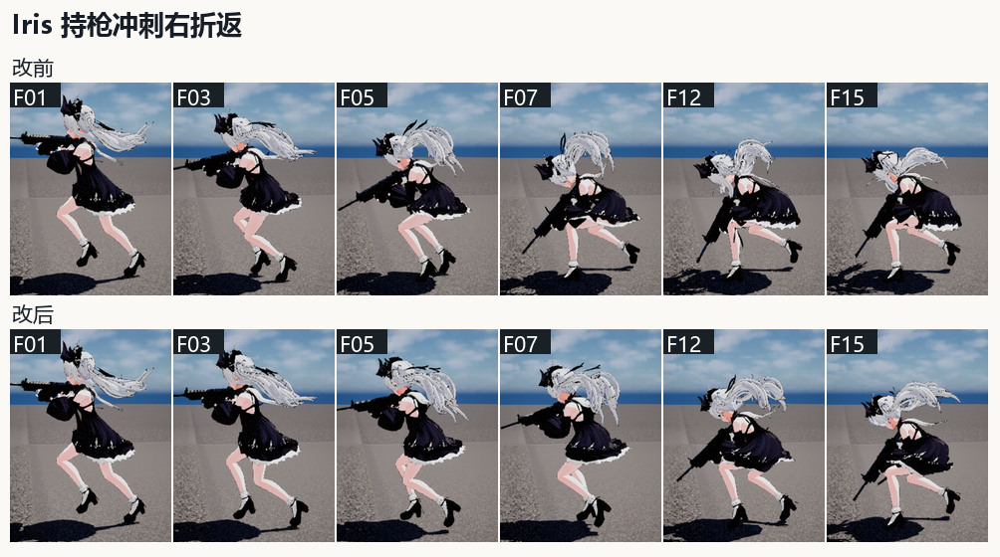
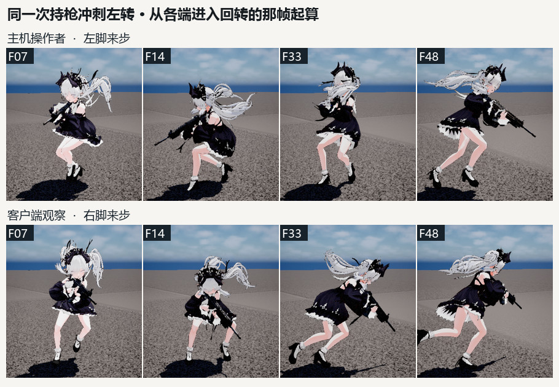
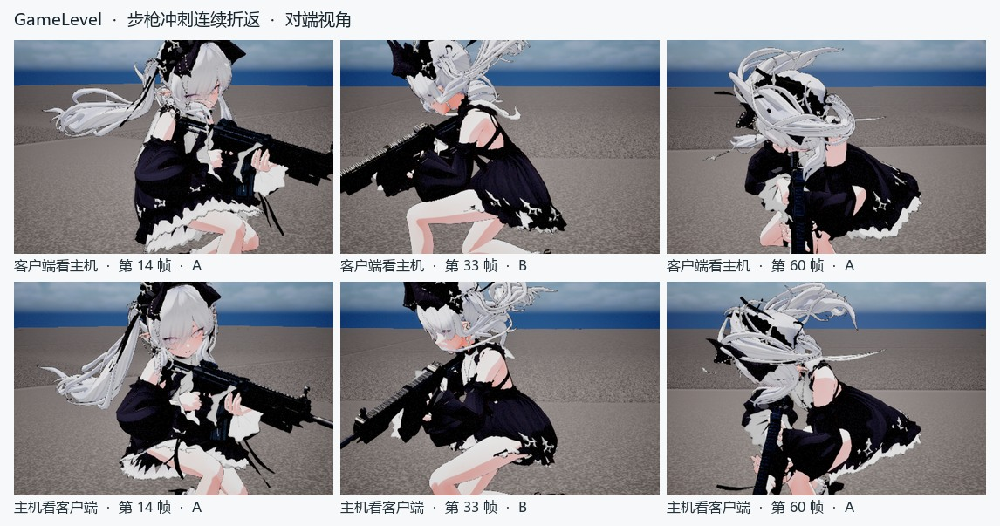

# Iris 冲刺折返与护木握持

[角色与战斗设计](../CombatDesign.md) · [回转 A/B 与步相匹配](LocomotionTransitions.md#turnaround-的三层接线与连续折返)

## 从哪个状态进入

同样是直跑时松 W、按 S，身体随移动转向时走 Turnaround，身体随镜头朝向时走 Pivot。新朝向输入仍需满足地面折返条件。首次回转的默认门槛是来速 150 cm/s、反向夹角 150°；已经在回转中时，允许在制动低速段再次反向。

| 游戏状态 | 180° 折返 | 动画来源 |
| --- | --- | --- |
| 空手普通跑 | Turnaround A/B | 共享层四条 Run |
| 空手冲刺 | Turnaround A/B | 共享层四条 Sprint |
| 持步枪冲刺 | Turnaround A/B | 同四条 Sprint，武器层提供持枪上身 |
| 持步枪随镜头移动，包括腰射、肩射、ADS | Pivot | 武器层原有方向性 Pivot |

`ATPSCPPCharacter::SetMovementFacing` 统一写入角色转向设置。拥有者随输入更新，服务器把朝向模式复制给模拟代理；装备通知和冲刺标签的先后顺序不会覆盖模拟代理收到的朝向。主动画蓝图用这个模式控制原有 `PivotSources → Pivot` 的入口，共享 A/B 的选片依据步态、转身侧和支撑脚。

## 动画在哪里调

- **脚步和接步**在 `ABP_ItemAnimLayersBase → Class Defaults → Anim Set → Turnaround`。四条专用 Sprint Turn 从 Game Animation Sample 重定向到 Quinn，水平移动由胶囊驱动。每条资产保留源片髋部压低、脚部 IK 目标、入口步相、支撑脚采样，以及校准到 600 cm/s 的参考速度曲线。Sprint 的左右来步按入口窗口实测的低脚配置。
- **持枪上身**在武器子层的 `SprintCarryPose` 和 `SprintCarryTime`。步枪取 `MM_Rifle_Jog_Fwd` 的 0.217 s，手枪取 `MM_Pistol_Jog_Fwd` 的 1.083 s；取样帧按一个循环中最接近平均前臂和手部姿势的位置选定。共享层在正常 A/B 输出上用 `UpperBodyMask` 按骨混合，旋转使用骨骼局部空间，让双肩和枪随胸口一起转。换装备时的快照走独立输入。
- **护木握点**在武器网格的 `LeftHandSocket`。Iris 读取握点相对挂枪骨的变换，`CR_Iris_Hand2Weapon` 在重定向后用本帧 `Right-wrist` 重建左手目标的位置和方向。沿用原来的双骨 IK、手腕朝向约束，以及换弹时释放左手的条件。此处没有增加手臂拉伸。其他蓝图调用 `GetLeftHandSocketData` 时默认仍得到网格组件空间的结果。

## 冲刺折返入口的重心过渡

在 GameLevel 水平路段先前跑，再按 Shift 提速，随后松 W、按 S。直跑切冲刺和冲刺切回转是两个不同的入口。旧版持步枪右转的一组主机画面里，按 Shift 后前 12 帧骨盆单帧最大变化为 0.8 cm；折返进入第 2 帧，骨盆从 97.8 cm 降至 91.6 cm，第 7 帧回转片段已经占满权重。片段原有的低姿制动在很短的时间内接管了前跑姿势。

**调参位置**在 `ABP_Mannequin_Base → LocomotionSM → TurnaroundSources → Turnaround`。别名覆盖 Start、Cycle、Pivot 和 Stop。两条过渡都检查 `bTurnaroundActive`，其中 `GameplayTag_IsDashing` 为真时使用 **0.24 秒 Linear**，为假时使用 **0.099 秒 Linear**。同一输入试过 0.20 秒线性、0.19 秒惯性化和 0.24 秒 Hermite，最终采用的线性混合在主机操作者八组入口中的骨盆、躯干和鞋底位移峰值综合较低。A/B 内部再次换向继续用 0.10 秒三次曲线，正常回到 Cycle 用 0.20 秒。

**双端复测**使用 60 Hz 双人监听主机 PIE。主机和客户端各自操控一次完整序列，空手、步枪各做四次冲刺折返，错开换向时刻以覆盖不同来步。表中是换键后第 0–16 帧内八次折返的单帧最大值。骨盆取高度差的绝对值，躯干取髋部至颈部向量的三维夹角。鞋底取相邻两帧都在台面上方 3 cm 以内的采样点中最小水平位移，再取窗口峰值，仅用于比较近地滑移。

| 操作与观察 | 骨盆高度（cm/帧） | 躯干转角（°/帧） | 近地鞋底位移（cm/帧） |
| --- | ---: | ---: | ---: |
| 主机操作 · 操作者 | 6.4 → 3.3 | 8.4 → 5.7 | 18.2 → 7.0 |
| 主机操作 · 对端观察 | 6.3 → 3.1 | 8.2 → 5.9 | 15.3 → 6.8 |
| 客户端操作 · 操作者 | 7.2 → 3.5 | 9.3 → 6.2 | 22.0 → 14.5 |
| 客户端操作 · 对端观察 | 6.4 → 3.3 | 8.5 → 6.2 | 20.9 → 8.8 |

换键算第 0 帧。操作者的冲刺回转在第 2 帧开始取权重，满权重从第 7 帧移至第 16 帧；对端有时晚一帧。普通跑的操作者仍在第 7 帧达到满权重。步枪各轮采样中左腕到护木握点的距离均小于 0.01 cm。扩展到不同来步时，两端能进入同一回转状态，但有时会选中同转向的另一支撑脚片段：本次首次冲刺折返改前为 3/16 组、改后为 4/16 组。两端各自读取本地前跑步相，观察端晚一帧时应同时核对步相与片名。

## 为什么两端偶尔选到不同的支撑脚

在 60 Hz GameLevel 双人 PIE 中，沿用上节的输入和换向时刻，补采主骨架的 `foot_l`、`foot_r`、加速度、角色朝向和 Locomotion 同步标记。原来的 4 组分歧均复现，两端每次都进入 A，步态和转身侧一致。

**选片顺序。** 主动画实例在首次检测到反向加速度时读取本地 Mannequin 两个脚踝的组件空间高度，左踝不高于右踝就锁定左脚，否则锁定右脚。角色实际转过至少 2° 后，物品层按冲刺、转身侧、已锁定的脚选片，再用步相和接触点的位置、速度在片内选起播帧。游戏同步了移动朝向模式，各端自行计算低脚。0.24 秒的入口混合在选片之后生效。[锁定低脚的实现](../../Source/TPSCPP/Animation/TurnaroundAnimation.cpp) · [选片和片内选帧的实现](../../Source/TPSCPP/Animation/TurnaroundAnimLayer.cpp)

| 操作端与折返 | 按 Shift 到换向 | 操作者踝高差 → 低脚 | 观察者踝高差 → 低脚 |
| --- | ---: | ---: | ---: |
| 主机，持步枪左转（第 6 组） | 66 帧 | −10.43 cm → 左 | +4.58 cm → 右 |
| 客户端，空手左转（第 1 组） | 54 帧 | +23.56 cm → 右 | −40.27 cm → 左 |
| 客户端，空手左转（第 2 组） | 66 帧 | −42.99 cm → 左 | +7.54 cm → 右 |
| 客户端，空手右转（第 4 组） | 89 帧 | +11.49 cm → 右 | −36.26 cm → 左 |

踝高差为左踝 Z 减右踝 Z。表格使用各端首次出现反向加速度前最后一帧已求值的主骨架姿势。四组均为操作者第 1 帧、观察者第 2 帧的姿势；新片段分别在第 2、3 帧可见。对全部 16 组、双方共 32 次首次选择逐一核对，高度比较和实际片名全部吻合。

**客户端操作的三组。** 上轮测试每组开始时在服务器传送角色并将朝向清为 0°。按 W 时，两端速度都已归零，客户端仍朝约 ±179°，监听主机上的角色朝 0°。客户端用了 `MM_Unarmed_Jog_Bwd_Start`，主机用了 `MM_Unarmed_Jog_Right_Start`；随后虽都进入前跑，换向前两端的脚步已经错开。对照时保留相同的传送位置、输入和时刻，仅保留角色原朝向。三组起跑时两端各自同向，客户端操控的八次首次折返由 3/8 分歧变为 0/8，观察端仍晚一帧。

**主机操作的步枪左转。** 两端按 W 时都朝 0°。换向后第 1 帧，主机和客户端都还是左脚低，踝高差分别为 −10.43 和 −2.64 cm。客户端的前跑步相已略超前，等它收到反向加速度时，最新的姿势已越过换脚点，踝高差变为 +4.58 cm。两端分别按各自当时的姿势选对了低脚。主机另做一轮连续场地对照，从第二组开始不重设位置和朝向，八次冲刺有 1 次支撑脚不同（组号 6）。

### 另一只脚制动时，玩家会看到什么

主机持步枪左转的分歧回放中，两端各自连续播放选中的片段。以各端开始回转为第 0 帧，60 Hz 下，第 14 帧骨盆离地高度分别为 64.4 和 73.3 cm。第 33 帧，两端角色朝向都约为 −179°，主机画面里 Iris 已直起，客户端画面里仍压身。用髋骨至颈骨的连线量躯干相对竖直的倾角，分别为 5.2° 和 50.0°。到第 40 帧仍差约 33°。前 40 帧两端左腕到各自枪上握点的距离均小于 0.01 cm。

在同输入的另一次回放里，两端都选左脚片段。第 33 帧两端倾角均约为 5.2°，前 40 帧的两端倾角差峰值为 1.1° 以内。不同来步片段的差别会延伸到起身时机和全身轮廓；单看某一端时，角色沿本端选中的片段跑出。

下图为双端同机位复现。为拍到换脚边界，换向键比原回放晚一帧，仍采到左脚与右脚两条片段。第 33 帧可对照起身幅度，第 48 帧可对照后腿抬起的高度。

## GameLevel 双端如何复测

使用双人监听主机 PIE、固定 60 Hz 的同一水平路段。主机和客户端轮流操控，逐帧读取操作者、观察者各自的主状态、A/B 权重、片段和枪上握点。常规组在第 0、27、52 帧反向；快速组在第 0、18、21 帧反向。帧号从第一次换键计起。

| 最终版步枪冲刺 | 操作者进入 A、B、A 的帧 | 对端进入 A、B、A 的帧 |
| --- | --- | --- |
| 主机操作，常规组 | 2、29、54 | 2、29、54 |
| 客户端操作，常规组 | 2、29、54 | 3、30、55 |
| 主机操作，快速组 | 2、20、26 | 3、20、26 |
| 客户端操作，快速组 | 2、20、26 | 3、21、27 |

最终回放中，空手普通跑、空手冲刺、步枪冲刺的操作者和对端在每次切换选中的状态、转身侧与来步片段均一致。观察端进入状态相差 0–1 帧。后两次指令只隔三帧时，第三次请求在上一段淡出完成后使用 A。步枪腰射、肩射在相同换向输入下走 Pivot。另做了 ADS 折返、冲刺回转中起跳及切肩射的回归；ADS 走 Pivot，后两项均能中断 Turnaround。

**左手是否滑离护木。** 在两组步枪连续折返中，从第一次换键到第 70 帧，同时采样 Iris 的 `Left-wrist` 和该角色实际武器的 `LeftHandSocket`。两个操作端、各自的两个观察视角合计 568 个样本，最终版腕骨到握点的最大距离小于 **0.01 cm**。额外取拇指、食指、中指的末节骨，在枪坐标系内与换键前一帧比较，最大位移分别为 **0.17、0.89、1.51 cm**；手指仍随姿势改变。截图与骨骼数据覆盖本地监听主机 PIE 下的这把突击步枪。

排查时，沿用上一帧的组件空间握点会让左腕在急转时明显滞后。改成同帧握点后，最终支撑脚配置在网格空间旋转混合下还有一帧差 **4.47 cm**；只把回转持枪覆盖切为局部旋转混合，同输入的这个峰值降到 **0.01 cm** 以下。改动局限于回转持姿的混合节点，Pivot 仍使用自己的蒙版与旋转设置。
