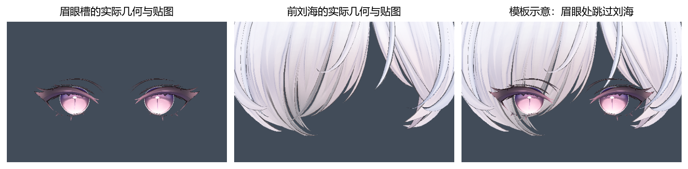

# Iris 眼透教程：让刘海只在眉眼处让开

[项目文档](../README.md) / 角色渲染 · UE 5.8

看下面三张图。左边是 Iris 模型里单独分出来的眉眼，中间是前刘海。右边只改变一条绘制规则：**刘海遇到眉眼覆盖的屏幕像素就让开，遇到额头仍照常画。** 这就是这份教程要复现的眼透。

图用项目导入源 `iris2.fbx` 的几何和项目贴图重建。为看清重叠关系，省略了脸、后发和光照。右图是规则示意；下文的 UE 模板方案是练习步骤，尚未在工程中实施或经 PIE 验收。

**阅读路线。** 想知道自己当初为什么成功，读[现有做法](#一当前工程为什么能看到眉眼)。第一次接触渲染，接着读[一个像素的三个问题](#二一个像素的三个问题)和[原作者的材质](#三iris-原作者怎样使用模板)。准备动手时，从[编辑器练习](#四在-ue-58-里搭建模板眼透)开始。效果不对可直达[排错](#五用画面症状排错)。

## 一、当前工程为什么能看到眉眼

在 Content Browser 打开 `/Game/Characters/Iris/iris2`，查看 LOD0 的材质区段。选中或隔离最后两个区段，交替观察虹膜和脸前的发片。这里的编号从 0 开始。

| LOD0 区段 | 实际材质实例 | 父材质与混合模式 | 在这张图里的角色 |
| --- | --- | --- | --- |
| 10 | `Hair` | `M_NPR` · Masked | 主体头发，保留的像素参与常规深度遮挡 |
| 11 | `Hair_Transparent_` | `M_Eye` · Translucent | 包含前刘海，采样 `basecolor_hair` |
| 12 | `face_eyebrown` | `M_Eye` · Translucent | 包含眉毛、眼线和虹膜，采样 `basecolor_face` |

注意槽 11 名称末尾的下划线。目录里另有 `Hair_Transparent_2`，它继承 `M_NPR`，混合模式为 Masked。判断谁在画刘海要看网格上实际绑定的实例。[Iris 网格](../../Content/Characters/Iris/iris2.uasset) · [Iris 材质实例目录](../../Content/Characters/Iris/mat/)

**看贴图。** 在 `M_Eye` 的输出节点从 `Opacity` 反向追线，会遇到一个 `Min`。一侧是角色溶解遮罩，另一侧是同一份 `ALBD` 贴图的 Alpha 自乘。假设溶解遮罩为 1，发片某点的 Alpha 为 0.5，最终不透明度就是 0.25；Alpha 为 1 的发片内部仍可完全盖住底色。改变这个乘法会改变发丝边缘，却无法告诉材质“这根发丝后面恰好有眼睛”。[M_Eye](../../Content/Assets/Materials/M_Eye.uasset)

**看绘制顺序。** 两个半透明区段属于同一组件，组件排序优先级为 0。UE 5.8 的 `FSkeletalMeshSceneProxy` 把区段索引写入 `MeshIdInPrimitive`，半透明绘制使用的排序键包含这个值。检查时，LOD0 的 11、12 区段分别映射到同号材质槽，命令行编辑器的 `r.OIT.SortedPixels` 为 0。在这个普通排序路径下，刘海可以先混合到场景颜色，眉眼再混合上去。刘海没有像实心几何那样写常规深度，所以眉眼即便在它后面也有机会通过深度测试。这是依据资产和引擎源码作出的解释；要确认某一帧的实际先后，可在 GPU 帧捕获中检查这两个 draw call。

**看开关。** `M_Eye` 的 `Disable Depth Test` 为关，`Allow Custom Depth Writes` 为开。后者允许半透明材质参与自定义深度绘制，还需要组件主动参与。角色蓝图默认的 Iris 组件没有开启 `Render CustomDepth Pass`，上述透明度接线也没有读取模板。因此，单独切换这个材质许可，无法给眉眼生成一条可供刘海判断的规则。[角色蓝图](../../Content/Blueprints/Character/BP_ThirdPersonCharacter.uasset)

## 二、一个像素的三个问题

设相机正看 Iris 左眼，视线依次穿过刘海、上眼线、脸。把屏幕上的这个位置记作 P。画 P 时，可以分别问三个问题。

**1. 哪个表面在前面？——深度。** 深度测试把正在画的表面同已记录的深度比较；深度写入决定这次绘制是否更新那份记录。Opaque 和 Masked 保留下来的像素通常会写场景深度，后画的眼睛若在其后，就会被挡住。普通 Translucent 表面通常会测试已有场景深度，并把颜色混入画面，但不会像 Opaque 一样更新常规深度。于是两层透明表面的画法会受顺序影响。对一个组件调高 `Translucency Sort Priority` 会改变它与其他透明组件的关系，无法单独指定同一组件里某个眼部槽的像素。

**2. 这层颜色占多少？——Alpha。** 如果先画眼睛再画刘海，普通透明混合可近似写成 `C = A × Hair + (1 − A) × Eye`。刘海的 A 为 1 时只看见发色，为 0.25 时大约保留四分之一发色。若刘海后面是额头，公式里的底色自然变成肤色。把整片刘海的 A 调低，会让眼睛和额头一起显出来。Masked 使用 `Opacity Mask` 与裁切阈值，每个采样点只有保留和丢弃两种结果，适合界定眉眼轮廓。Translucent 的 `Opacity` 可以表达连续浓淡，适合控制重叠处还剩多少发色。[Epic 材质混合模式](https://dev.epicgames.com/documentation/unreal-engine/material-blend-modes-in-unreal-engine)

**3. 这个位置是否属于眉眼？——模板。** 模板给每个屏幕像素存一个 0–255 的整数。取 10 当作眉眼标签，先在眉眼形状上写入 10，之后刘海就能针对 P 做判断。10 只是双方约定的编号，没有透明度含义。贴图 Alpha 随模型 UV 采样；模板随当前相机投影生成。转动头部时，两者仍能在屏幕上找到新的重叠位置。

| 同样是刘海上的像素 | 眉眼是否在这里写了 10 | 原作者 VRC 规则 | 柔和版的例子 |
| --- | --- | --- | --- |
| P 落在上眼线 | 是 | 跳过这一次刘海绘制，留下眼线 | 刘海原不透明度乘 0.25 |
| 隔壁像素落在额头 | 否 | 照常画刘海 | 刘海原不透明度乘 1 |

**自测。** 一堵实心墙进入相机与角色之间时，墙应遮住整个角色。眉眼的常规材质仍要接受场景深度测试。关闭深度测试会让它有机会覆盖前面的墙，也不能指定“只透自己的刘海”。UE 的 `CustomDepth` 和 `CustomStencil` 是额外的缓冲：前者给出参与对象的深度，后者给出标签。一个对象即使被主场景挡住，也可能出现在这两个缓冲里；后文处理侧后方和多人重叠时就要用到这个区别。[Epic 自定义深度与模板说明](https://dev.epicgames.com/documentation/unreal-engine/post-process-materials-in-unreal-engine?lang=en-US)

## 三、Iris 原作者怎样使用模板

以下设置来自 VRC 原包 `Iris 1.03.unitypackage` 的 `Assets/Iris/Material/`。同目录的 VRM 版采用 MToon 并有独立的队列与深度设置。复查下面这些值时应打开 VRC 版。

| VRC 材质 | 包内设置 | 读法 |
| --- | --- | --- |
| `Body (Stencil) Eyebrown` | `Ref 10`、`Comp Always`、`Pass Replace`、`ZWrite 1`；队列为着色器默认值 | 模板比较总是通过；深度也通过的眉眼像素，将模板改写为 10 |
| `Hair (Transparent)1` | `Ref 10`、`Comp NotEqual`、`Pass Keep`、队列 2001 | 模板值不是 10 时才画这一层发片，保留原标签 |
| `Hair (Transparent)2` | 同样是 `NotEqual 10`、`Keep`，队列 2005 | 第二层发片也避开相同的眉眼区域 |

普通 `Hair.mat` 没有上述排除条件。原作者既用材质分区规定了**哪些发片**可以透，又用模板规定了**这些发片的哪些像素**可以透。UE 里可以用下面的材质采样方法实现相同的视觉规则；Unity 的 2001、2005 无需照搬。若直接读 Unity 材质序列化文本，`_StencilComp = 6` 对应 NotEqual，`8` 对应 Always，`_StencilPass = 2` 对应 Replace。[Unity Stencil 命令与枚举值](https://docs.unity.cn/6000.1/Documentation/Manual/SL-Stencil.html)

## 四、在 UE 5.8 里搭建模板眼透

用角色蓝图副本和单独材质做练习，在测试地图中放一个 Iris，镜头固定在正面。保持发片、脸和眼睛的几何位置不动。先得到一张形状正确的模板，再接刘海透明度，这样每一步都能单独判断。

### 第一步：准备可见眉眼和刘海

1. 从 `M_Eye` 派生出两份可独立编辑接线的材质副本，一份用于可见眉眼，一份用于前刘海。材质实例可以改参数；这一步要改输出接线，所以需要能编辑图的父材质。保留原实例的 `ALBD` 纹理覆盖：眉眼用 `basecolor_face`，刘海用 `basecolor_hair`。
2. 可见眉眼设为 **Masked**。把原材质送入 `Opacity` 的 `Min` 结果改接到 `Opacity Mask`，保留原有 NPR 着色接线。这样纹理 Alpha 和溶解继续控制轮廓，可见眉眼在常规深度阶段绘制。若眉线过细或断开，在近景观察并调整裁切阈值。
3. 刘海保留 **Translucent** 和原有 `Opacity`，保持深度测试开启。先给副本角色的槽 12 和槽 11 分别指派眉眼、刘海测试实例。此时近乎实色的发束应能遮住眉眼，发丝原本较透的地方仍能透底。这是后面比较 0 和 1 的起点。

### 第二步：只写出眉眼的轮廓

在 **Project Settings → Rendering** 搜索 `Custom Depth-Stencil Pass`，选 `Enabled with Stencil`。此前项目命令行编辑器读取的 `r.CustomDepth` 是 1；带模板的设置对应 3。按编辑器提示完成必要的重启或着色器编译。项目瞄准镜已有默认模板值 1，本练习用 10。[项目瞄准镜参数](../../Source/TPSCPP/Weapon/WeaponData.h)

Iris 的 `Custom Depth Stencil Value` 设在组件上，而目前的 13 个材质槽属于同一个组件。要得到左图的形状，可以在源模型中仅导出已有的 `eyebrown` 网格和所需骨架，保留 UV、蒙皮和绑定姿势，导入 UE 时选择 Iris 的现有 Skeleton。在测试角色上新增这个眉眼骨骼网格组件作为**遮罩代理**。它和可见眉眼占同一位置，但只负责写标记。

| 遮罩代理的设置 | 练习值与原因 |
| --- | --- |
| 挂接与姿态 | 挂到 Iris 网格组件，保持相同局部变换。用 `Set Leader Pose Component` 让代理跟随 Iris 的骨骼姿态；眨眼等表情若由 Morph Target 驱动，核对代理的同名形态与实际权重。 |
| 材质 | 使用与可见眉眼一致的 Masked 裁切轮廓。淘汰时若角色动画更新 `Dissolve`，代理也要收到同样的参数更新。 |
| `Render CustomDepth Pass` | 开，`Custom Depth Stencil Value` 设为 10，写掩码允许写入该值。 |
| `Render in Main Pass`、`Render in Depth Pass`、`Cast Shadow` | 关。代理仍保持可见且参与 CustomDepth；常规场景颜色、遮挡和阴影交给原角色。 |

**检查点。** 在视口打开 **View Mode → Buffer Visualization → Custom Stencil**。正面应只有眉眼形状被标记，转头时标记紧贴眼睛。可视化的颜色或亮度取决于显示方式；先看轮廓，必要时用下一步的等值判断验证数值。若整个人都有标记，先检查是不是把开关设到了完整 Iris 组件上。若模板轮廓不对，先修代理，暂时无需调整刘海。

### 第三步：让刘海读取标记

打开**刘海专用父材质**。它负责读取模板，关闭从 `M_Eye` 继承来的 `Allow Custom Depth Writes`；由上一步的独立代理承担写入。保留刘海自己的正常深度测试。在材质图右端找到原来连入 `Opacity` 的线，下表称它为 `OriginalOpacity`。

| 节点 | 具体接法 |
| --- | --- |
| `SceneTexture` → `ComponentMask` | 将 Scene Texture Id 选为 `CustomStencil`。UV 留空，使用当前屏幕像素。Color 输出接 ComponentMask，只取 R。读出的是整数标签，直接与 10 比较。 |
| `If` 的比较输入 | A 接上述 R，B 接常量 10。 |
| `If` 的三个结果输入 | `A > B` 接 1，`A < B` 接 1，`A == B` 接标量参数 `EyeHairOpacity`。参数范围设为 0–1。 |
| `Multiply` → `Opacity` | 一端接 `OriginalOpacity`，另一端接 `If` 输出；乘积接最终 `Opacity`。原溶解与发丝 Alpha 链保持在乘法之前。 |

在材质实例里切三次数值。**1** 给出原刘海遮挡；**0** 完全露出被标记的眉眼；**0.25** 让重叠处保留原不透明度的四分之一。例如原不透明度为 0.8，乘完是 0.2。切换时观察同一发束压住眼线和额头的两个点：眼线上应有变化，额头上应保持原样。这个对照比单看一张好看的正面截图更能说明接线正确。

### 第四步：处理转头、遮挡和多人重叠

先从正面转到侧后方。CustomStencil 存的是屏幕位置的标记，即便眉眼被后脑挡住，这个位置仍可能有值。要把效果限定在贴近眼睛的前刘海，可在刘海材质中同时采样 `CustomDepth`，与当前发片的 `PixelDepth` 用相同的线性深度单位比较。正面相机先看见发片、再看见眉眼时，`CustomDepth − PixelDepth` 通常是一个较小的正值。只在标签匹配、深度差落在小容差到允许间距的区间内启用眼透。以实际发片位置、头部转角和动画来定容差；若设计要求侧面逐渐收回，还可以用头部朝向相对视线的夹角淡出。

再放第二个 Iris，使两人部分重叠。若两人都写 10，前一人的刘海可能采到后一人的眉眼。深度差能挡掉相距很远的误匹配；近距离交错时还需区分所属角色。一种做法是在同一视图内为需要区分的角色分配不同的可用模板编号，代理写自己的值，刘海动态材质实例把相同值传给 `If.B`。同时避开瞄准镜等已有模板用途。CustomDepth/Stencil 每个像素只能保存当前通过深度测试的一层，角色重叠时有可能缺少某人的遮罩信息；这个场景需要用实际游戏镜头取舍。

## 五、用画面症状排错

| 看到什么 | 怎样区分原因 |
| --- | --- |
| `EyeHairOpacity` 从 1 调到 0，整片刘海都消失 | 检查两条不等分支是否都接 1，再看 Custom Stencil 是否标记了整脸或全身。 |
| 数值怎么调都没有变化 | 确认槽 11 使用新实例；核对模板开关、代理形状和编号。可临时用 `If` 的等值分支输出 1、其余输出 0，送到 Emissive，以固定不透明度观察刘海上的黑白分区，然后恢复正式接线。 |
| 刘海让开了，露出来的是皮肤 | 单独显示槽 12，检查它是否仍在主画面绘制、是否使用脸部图集，以及可见眉眼是否被过高的 Masked 阈值裁掉。模板只指示哪里让开，不保存虹膜的颜色。 |
| 转头、眨眼或淘汰时出现悬空眉线 | 定格动作，对照正常画面与模板缓冲，依次核对组件变换、骨骼姿态、Morph 权重和溶解参数。 |
| 主视角正常，侧后方或另一名角色出现眼形缺口 | 固定遮罩与刘海参数，先单角色转头，再让两人交错，分别检查深度差和角色编号。 |
| 眼睛透过实心墙或角色开镜后仍留眼形 | 用一堵 Opaque 墙遮住整张脸，检查可见眉眼与刘海的深度测试；再检查本地 ADS 隐藏第三人称网格时代理是否同步停止写入。 |

学会后的判断方法是回到开头的两个像素：**眼线上，标签决定刘海还保留多少颜色；额头上，刘海仍按自己的材质绘制。** 如果同一根发束能同时满足这两个条件，再去调颜色和强度，改动的含义就清楚了。
